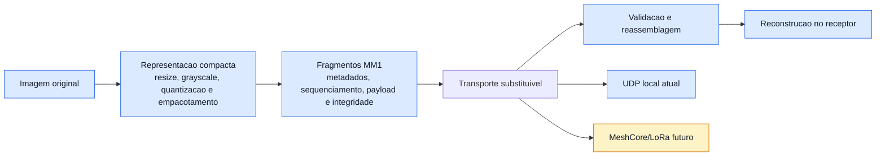
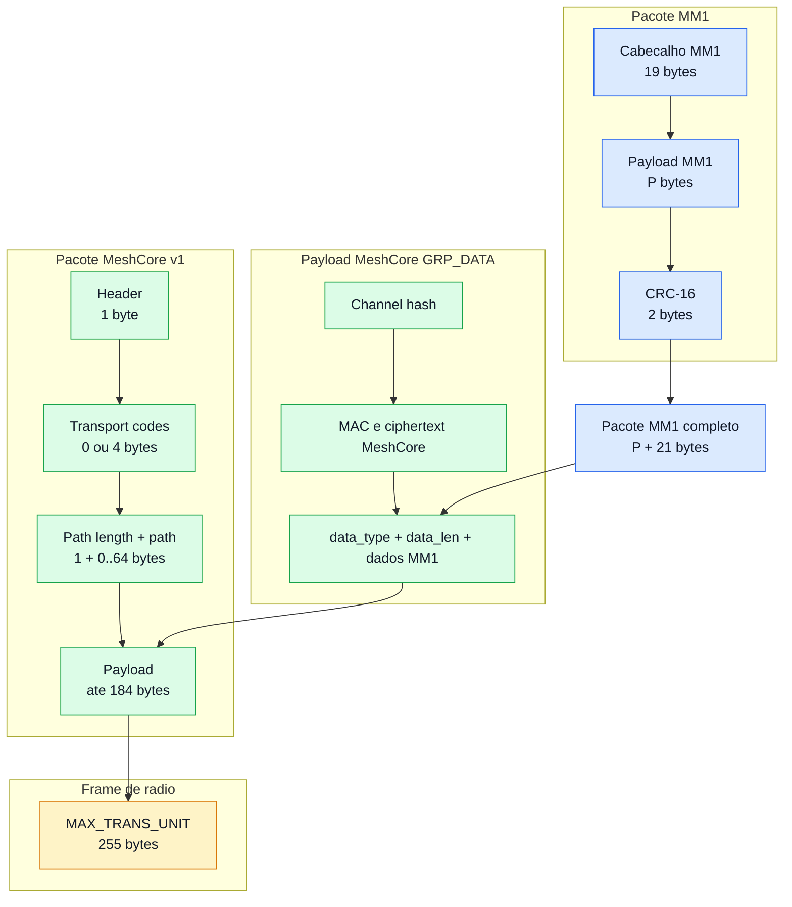

# MeshMedia Lab


O MeshMedia Lab e uma iniciativa brasileira, cooperativa e de codigo aberto.
O projeto e construido de forma colaborativa para que ideias, experimentos,
referencias e decisoes tecnicas possam ser compartilhados e revisados pela
comunidade.

Ferramentas de inteligencia artificial participam como apoio a pesquisa,
documentacao, analise e desenvolvimento. A IA nao substitui a revisao humana:
as decisoes de arquitetura, os experimentos, os testes e a responsabilidade
pelo codigo permanecem com os colaboradores do projeto.

## MM1 - MeshMedia v1

O MM1 (MeshMedia v1) e o protocolo experimental que estamos criando para
transportar representacoes compactas de midia em redes com pouca largura de
banda, payload reduzido e alto custo de airtime, como redes MeshCore/LoRa.

O objetivo nao e simplesmente enviar um arquivo JPEG ou um audio convencional
atraves do radio. Arquivos tradicionais normalmente assumem uma rede com mais
capacidade, menor perda e retransmissao barata. Em uma rede mesh de baixa taxa,
uma imagem pequena ainda pode ocupar muitos pacotes, consumir o canal por muito
tempo e falhar completamente se poucos fragmentos forem perdidos.

O MM1 tenta resolver esse problema tratando a midia, desde a origem, como uma
representacao adequada ao canal:



### O que o MM1 é?

- Uma camada de protocolo para transportar midia fragmentada.
- Uma forma de levar metadados suficientes para o receptor decodificar a
  representacao sem compartilhar configuracoes escondidas com o transmissor.
- Um laboratorio para medir bytes uteis, overhead, quantidade de pacotes,
  perdas, recuperacao e airtime.
- Uma arquitetura que separa codec, protocolo, simulacao de canal e transporte.

### MM1 dentro do pacote MeshCore

O MM1 nao substitui o pacote MeshCore. Ele ocupa o espaco de dados de um
payload MeshCore, que por sua vez e transportado dentro do frame de radio:



Para `GRP_DATA`, o limite conservador do dado de aplicacao e 165 bytes. Como o
pacote MM1 atual possui `P + 21` bytes, o payload MM1 precisa respeitar:

```text
P + 21 <= 165
P <= 144 bytes
```

O valor padrao atual do MM1 e `P=64`, portanto um pacote MM1 ocupa 85 bytes e
comporta-se dentro desse limite. O limite de 255 bytes do frame MeshCore nao e
o mesmo que o payload disponivel para o MM1.

Os detalhes do formato, dos tipos de payload MeshCore, dos caminhos e das
alternativas `GRP_DATA`/`RAW_CUSTOM` estao em
[`docs/meshcore-reference.md`](docs/meshcore-reference.md).

### O que o MM1 nao e

- Nao e um substituto do MeshCore nem uma implementacao de radio.
- Nao e apenas um codec de imagem.
- Nao promete transmitir fotografias convencionais com qualidade original.
- Nao considera FEC, Reed-Solomon ou retransmissao como funcionalidades prontas.

### O problema de engenharia

O projeto precisa encontrar um equilibrio entre quatro custos que normalmente
ficam escondidos quando usamos uma rede convencional:

| Custo | Pergunta do MM1 |
|---|---|
| Representacao | Qual imagem minima ainda transmite informacao util? |
| Fragmentacao | Quantos bytes cabem em cada mensagem sem desperdicar payload? |
| Integridade | Como detectar um fragmento corrompido antes da reassemblagem? |
| Recuperacao | E melhor adicionar redundancia ou retransmitir o que faltou? |

Por isso o MM1 separa deliberadamente as decisoes. Primeiro validamos uma
representacao, um formato de pacote e um pipeline local. Depois medimos perda,
corrupcao, overhead e airtime. Somente entao decidimos se FEC, Reed-Solomon,
retransmissao seletiva ou uma combinacao dessas tecnicas vale o custo na rede
real.

### Estado atual do MM1

O formato binario inicial e o protocolo versao `1`. Atualmente o laboratorio ja
possui encoder e decoder grayscale, fragmentacao, reassemblagem fora de ordem,
cabecalho com metadados e CRC-16/CCITT-FALSE por pacote. O transporte validado
e local, usando UDP ou memoria, e o canal pode simular perda e corrupcao
independentes por pacote.

Ainda nao estao implementados FEC, Reed-Solomon, ACK/NACK, retransmissao
seletiva, transmissao progressiva ou um adaptador MeshCore. Essas tecnicas
aparecem no SDD como propostas e experimentos, nao como capacidades existentes.

O `1` de MM1 identifica a primeira versao do protocolo no cabecalho. Ele nao e a
versao do pacote Python: a implementacao de referencia atualmente e `0.1.0`.

O projeto segue o documento de Specification-Driven Development em
[`sdd/sdd.md`](sdd/sdd.md). A relacao entre a especificacao e o codigo esta em
[`docs/implementation-status.md`](docs/implementation-status.md).

Documentacao complementar:

- [`docs/architecture.md`](docs/architecture.md): limites e fluxo dos componentes.
- [`docs/meshcore-reference.md`](docs/meshcore-reference.md): formato MeshCore, limites de pacote e encaixe do MM1.
- [`docs/error-control.md`](docs/error-control.md): CRC, FEC, Reed-Solomon e plano de afericao.
- [`docs/references.md`](docs/references.md): referencias academicas, normativas e tecnicas.
- [`CHANGELOG.md`](CHANGELOG.md): historico de software, protocolo e especificacao.

A pasta [`apps/`](apps/README.md) contem as aplicacoes de teste local do
protocolo. Elas permitem executar TX e RX em processos separados, observar os
datagramas UDP, medir a quantidade de mensagens e visualizar a imagem
reconstruida sem alterar o nucleo do codec.

## Estrutura

```text
.
├── docs/                    # Decisoes e arquitetura do laboratorio
├── sdd/                     # Especificacao orientadora do projeto
├── apps/                    # Aplicacoes e README dos testes locais
│   └── local/               # TX, RX, logs e integracao Pillow
├── src/meshmedia_lab/
│   ├── application/         # Casos de uso e pipeline
│   ├── codec/               # Encoder e decoder de imagem
│   ├── protocol/            # Pacotes, CRC, fragmentacao e reassemblagem
│   ├── simulation/          # Simulacao de canal
│   └── transport/           # Adaptadores, transmissor e receptor
├── tests/
│   ├── integration/         # Testes do pipeline completo
│   └── unit/                # Testes isolados por componente
├── benchmarks/              # Experimentos de desempenho
└── pyproject.toml
```

## Desenvolvimento

O nucleo do projeto nao depende de bibliotecas de imagem ou de radio na
primeira fase. Isso permite validar o pipeline localmente antes da integracao
com MeshCore.

```bash
PYTHONPATH=src:. python3 -m unittest discover -s tests -p 'test_*.py'
```

Para usar as aplicacoes locais com Pillow e as ferramentas de desenvolvimento:

```bash
python3 -m pip install -e '.[local,dev]'
```

Com as dependencias instaladas, os testes tambem podem ser executados com:

```bash
python3 -m pytest -q
```

## Aplicacoes TX/RX locais

As aplicacoes locais simulam duas instancias independentes usando UDP em
`localhost`:

```text
apps.local.tx -> UDP localhost -> apps.local.rx
```

O TX usa o codec do pacote `meshmedia_lab`. O RX nao importa configuracoes do
TX: cada pacote carrega os metadados necessarios para decodificar a imagem.

O RX deve ser iniciado antes do TX.

### Terminal 1: RX

```bash
PYTHONPATH=src:. python3 -m apps.local.rx \
  --bind 127.0.0.1 \
  --port 9000 \
  --output artifacts/received.png \
  --display \
  --log-level DEBUG
```

O RX escuta os datagramas, valida o CRC, registra cada pacote, reassembla a
imagem, salva o resultado e abre o visualizador de imagens do sistema quando
`--display` e usado.

### Terminal 2: TX

```bash
PYTHONPATH=src:. python3 -m apps.local.tx \
  --image caminho/para/imagem.jpg \
  --host 127.0.0.1 \
  --port 9000 \
  --resolution 32x32 \
  --levels 16 \
  --payload 64 \
  --image-id 1 \
  --log-level DEBUG
```

Parametros importantes:

- `--image`: imagem de entrada aceita pelo Pillow.
- `--resolution`: resolucao alvo no formato `LARGURAxALTURA`.
- `--levels`: quantidade de tons de grayscale.
- `--payload`: quantidade maxima de bytes de dados por pacote.
- `--image-id`: identificador da transmissao.
- `--log-level DEBUG`: mostra os bytes completos de cada datagrama.
- `--log-file`: opcionalmente grava os logs em um arquivo.

### Formato do pacote

Cada datagrama UDP contem um pacote serializado pelo protocolo:

```text
Magic
Version
Media Type
Codec
Flags
Image ID
Fragment Number
Total Fragments
Width
Height
Grayscale Levels
Payload Length
Payload
CRC-16/CCITT-FALSE
```

O contador de mensagens da imagem e `Total Fragments`. O TX informa quantas
mensagens foram preparadas e enviadas; o RX informa quantas foram recebidas,
quantos bytes eram payload e quanto foi consumido pelo overhead.

Exemplo de log:

```text
TX msg=3/8 message_bytes=85
  image_id=1
  flags=0x00
  resolution=32x32
  levels=16
  payload_bytes=64
  overhead_bytes=21
  address=127.0.0.1:9000
  raw:
    4d 4d 01 01 01 00 00 01 00 02 00 08 00 20 00 20
    00 10 40 ...
RX msg=3/8 message_bytes=85
  image_id=1
  flags=0x00
  resolution=32x32
  levels=16
  payload_bytes=64
  overhead_bytes=21
  address=127.0.0.1:58533
  raw:
    4d 4d 01 01 01 00 00 01 00 02 00 08 00 20 00 20
    00 10 40 ...
RX summary
  messages=8
  payload_bytes=512
  message_bytes_total=680
  overhead_bytes=168
  invalid_packets=0
  expected_messages=8
```

### Teste com log em arquivo

```bash
PYTHONPATH=src:. python3 -m apps.local.rx \
  --port 9000 \
  --output artifacts/received.png \
  --log-level DEBUG \
  --log-file artifacts/rx.log
```

Em outro terminal:

```bash
PYTHONPATH=src:. python3 -m apps.local.tx \
  --image caminho/para/imagem.png \
  --port 9000 \
  --resolution 64x64 \
  --payload 20 \
  --log-level DEBUG \
  --log-file artifacts/tx.log
```

O tamanho do payload pode ser alterado para reproduzir os cenarios do SDD,
como `20`, `40`, `60`, `80` e `100` bytes.

## Testes locais via API

Os cenarios abaixo nao exigem uma imagem em disco e continuam uteis para
validar componentes isolados.

### Smoke test end-to-end

Este fluxo testa:

```text
Imagem -> Encoder -> Fragmenter -> Pacotes -> Receiver
       -> Reassembler -> Decoder -> Imagem reconstruida
```

```bash
PYTHONPATH=src python3 - <<'PY'
from meshmedia_lab.application.pipeline import ImagePipeline
from meshmedia_lab.protocol.fragmenter import Fragmenter

image = tuple(
    tuple((x * 32 + y * 16) % 256 for x in range(8))
    for y in range(8)
)

pipeline = ImagePipeline(
    fragmenter=Fragmenter(max_payload_size=16)
)

result = pipeline.transmit(image, image_id=123)

print("Bytes codificados:", result.encoded_size)
print("Pacotes enviados:", result.packets_sent)
print("Pacotes recebidos:", result.packets_received)
print("Dimensao reconstruida:", len(result.image), "x", len(result.image[0]))
PY
```

### Teste de perda de pacotes

```bash
PYTHONPATH=src python3 - <<'PY'
from meshmedia_lab.application.pipeline import ImagePipeline, TransmissionError
from meshmedia_lab.protocol.fragmenter import Fragmenter
from meshmedia_lab.simulation.channel import ChannelConfig, ChannelSimulator

image = ((0, 128), (255, 64))

pipeline = ImagePipeline(
    fragmenter=Fragmenter(max_payload_size=1)
)

channel = ChannelSimulator(
    ChannelConfig(loss_rate=1.0, seed=42)
)

try:
    pipeline.transmit(image, image_id=1, channel=channel)
except TransmissionError as error:
    print("Falha esperada:", error)
PY
```

### Teste de corrupcao

```bash
PYTHONPATH=src python3 - <<'PY'
from meshmedia_lab.application.pipeline import ImagePipeline, TransmissionError
from meshmedia_lab.protocol.fragmenter import Fragmenter
from meshmedia_lab.simulation.channel import ChannelConfig, ChannelSimulator

image = ((0, 128), (255, 64))

pipeline = ImagePipeline(
    fragmenter=Fragmenter(max_payload_size=1)
)

channel = ChannelSimulator(
    ChannelConfig(corruption_rate=1.0, seed=42)
)

try:
    pipeline.transmit(image, image_id=1, channel=channel)
except TransmissionError as error:
    print("Corrupcao detectada:", error)
PY
```

### Teste do transporte em memoria

Este cenario testa o adaptador de transporte, o transmissor, o receptor e a
reassemblagem fora de ordem.

```bash
PYTHONPATH=src python3 - <<'PY'
from meshmedia_lab.media import ImageMetadata
from meshmedia_lab.protocol import Fragmenter, Reassembler
from meshmedia_lab.transport import InMemoryTransport, Receiver, Transmitter

packets = Fragmenter(max_payload_size=3).fragment(
    b"abcdefgh",
    image_id=7,
    metadata=ImageMetadata(width=2, height=2, levels=16),
)

transport = InMemoryTransport()
sent = Transmitter(transport).transmit(packets)
raw_packets = transport.drain()

receiver = Receiver()
reassembler = Reassembler()

for raw_packet in reversed(raw_packets):
    reassembler.add(receiver.receive(raw_packet))

print("Pacotes enviados:", sent)
print("Completo:", reassembler.is_complete)
print("Dados:", reassembler.assemble())
PY
```

## Limitacoes atuais

- Nao ha comunicacao real com MeshCore.
- FEC, retransmissao e RLE ainda nao estao implementados.
- UDP local nao representa ainda perdas ou latencia de radio por padrao.
- A simulacao de perda e corrupcao permanece disponivel no componente de canal.
- O visualizador depende de um ambiente grafico; use `--output` em ambientes sem GUI.
