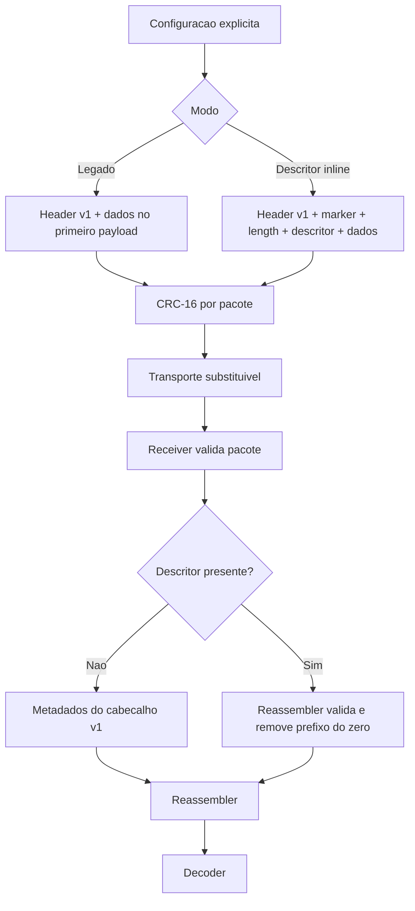
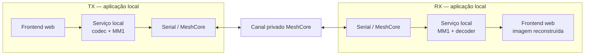

# Arquitetura do laboratorio

O laboratorio usa o layout `src/` para separar o pacote Python do codigo de
teste e dos artefatos experimentais. As fases do SDD descrevem a ordem de
evolucao; elas nao criam acoplamento entre as pastas.

As aplicacoes de teste local ficam fora do pacote principal. Elas simulam o
ambiente de uso sem transformar Pillow ou UDP em dependencias obrigatorias do
codec.

## Mapeamento do SDD

| Componente do SDD | Localizacao |
|---|---|
| Image Source | `src/meshmedia_lab/application/source.py` |
| Encoder | `src/meshmedia_lab/codec/encoder.py` |
| Decoder | `src/meshmedia_lab/codec/decoder.py` |
| Codec RGB332 | `src/meshmedia_lab/codec/rgb332.py` |
| Fragmenter | `src/meshmedia_lab/protocol/fragmenter.py` |
| Reassembler | `src/meshmedia_lab/protocol/reassembler.py` |
| CRC | `src/meshmedia_lab/protocol/crc.py` |
| Contrato FEC abstrato | `src/meshmedia_lab/fec/contract.py` |
| Packet/Header | `src/meshmedia_lab/protocol/packet.py` |
| Transmitter | `src/meshmedia_lab/transport/transmitter.py` |
| Receiver | `src/meshmedia_lab/transport/receiver.py` |
| Transport Adapter | `src/meshmedia_lab/transport/adapter.py` |
| Channel Simulator | `src/meshmedia_lab/simulation/channel.py` |
| Pipeline da aplicacao | `src/meshmedia_lab/application/pipeline.py` |
| UDP local | `src/meshmedia_lab/transport/udp.py` |
| Aplicacao TX | `apps/local/tx.py` |
| Aplicacao RX | `apps/local/rx.py` |
| Integracao Pillow | `apps/local/image_io.py` |
| Perfil de transmissao | `docs/transmission-profile.md` |
| Transmission Descriptor | `docs/transmission-descriptor.md` |
| Modelo/parser do descritor | `src/meshmedia_lab/protocol/descriptor.py` |
| Matriz de experimentos | `docs/experiment-matrix.md` |
| Experimento RGB332 | `benchmarks/rgb332_experiment.py` |

## Limites

- `codec` transforma imagens em uma representacao binaria e a reconstrui.
- `protocol` conhece a organizacao dos pacotes, mas nao conhece radio.
- `transport` envia e recebe bytes por uma interface substituivel.
- `simulation` injeta as condicoes de um canal sem alterar o protocolo.
- `application` coordena os componentes, sem implementar seus detalhes.
- `apps/local` fornece executaveis de validacao, sem ser parte do codec.
- O codec RGB332 aprovado usa o envelope MM1 v1 existente; o harness UDP
  experimental continua disponivel apenas para validacao local separada.

## Fluxo TX/RX local

```text
Arquivo de imagem
       |
       v
apps.local.tx -- Pillow -> matriz grayscale
       |
       v
ImageEncoder -> ImageMetadata + bytes codificados
       |
       v
Fragmenter -> Packet -> CRC -> UdpSender
       |
       | UDP localhost, um datagrama por mensagem
       v
UdpReceiver -> Packet.from_bytes -> CRC
       |
       v
Reassembler -> EncodedImage -> ImageDecoder
       |
       v
apps.local.rx -- Pillow -> arquivo e visualizacao
```

## Metadados no pacote

O RX precisa decodificar a imagem sem compartilhar configuracao com o TX.
Por isso, cada pacote transporta:

- Versao do protocolo.
- Tipo de midia.
- Identificador do codec.
- Identificador da imagem.
- Numero e total de fragmentos.
- Largura e altura.
- Quantidade de niveis de grayscale.
- Flags, payload e CRC.

O overhead atual e intencionalmente visivel nos logs. A otimizacao do
cabecalho fica para depois da medicao, conforme o SDD.

## Modos de transmissao MM1 v1

O caminho default continua sendo o modo legado. Cada fragmento possui o
cabecalho v1 de 19 bytes, metadados de imagem, payload e CRC. O primeiro payload
comeca diretamente com dados codificados.

O modo com descritor e uma extensao opt-in implementada no protocolo v1. Ele
mantem o cabecalho, o CRC e os fragmentos posteriores, mas coloca no primeiro
payload um prefixo compacto:

```text
header v1 | marker | descriptor_length | descriptor_body | dados
```

O `Reassembler` atualizado seleciona o modo pela flag `0x04` (todos os
fragmentos), usa o parser puro centralizado e remove o prefixo antes de montar
os dados. O receptor legado nao conhece esse prefixo; portanto os
modos devem ser selecionados explicitamente e nao sao transparentemente
interoperaveis.



O ADR 0004 substitui a proposta anterior de nao duplicar metadata: o corpo v1
repete midia, codec, dimensoes e levels e exige igualdade com os headers.
image_id e contadores nao sao repetidos. O corpo inclui versao e encoded_length
obrigatorio; compressao NONE, parametros extras vazios e nenhum campo FEC.
O limite de payload considera o prefixo de 19 bytes. O RX conserva dados fora de
ordem em armazenamento limitado pelo tamanho derivado de metadata validada,
nao prealoca por comprimentos arbitrarios e so decodifica apos descritor valido,
todos os fragmentos e tamanho exato. Erros estendidos sao terminais; CRC e
validado antes do parser. Legado comeca diretamente com dados, mesmo "TD".

## Interface FEC na arquitetura

FEC nao e parte do encoder de imagem nem do transporte. A camada implementada fica
entre os bytes codificados e a fragmentacao:

```mermaid
flowchart LR
    A[Image Encoder] --> B[Bytes codificados]
    B --> C[Particao em blocos]
    C --> D[FEC Encoder abstrato]
    D --> E[Simbolos de origem e reparo]
    E --> F[Fragmenter MM1 v1]
    F --> G[Packet + CRC]
    G --> H[Transport Adapter]
    H --> I[Packet + CRC validado]
    I --> J[FEC Decoder abstrato]
    J --> K[Bytes de origem]
    K --> L[Reassembler e Image Decoder]
```



O contrato abstrato de FEC esta implementado em
`src/meshmedia_lab/fec/contract.py` e documentado em
`docs/error-control.md`. Ele nao gera reparos nem integra o pipeline, o
protocolo ou o transporte. Reed-Solomon continua sendo candidato experimental.

## Execucao

Instale o extra local:

```bash
python3 -m pip install -e '.[local]'
```

Inicie o RX em um terminal:

```bash
PYTHONPATH=src:. python3 -m apps.local.rx --port 9000 --output artifacts/received.png --display --log-level DEBUG
```

Inicie o TX em outro:

```bash
PYTHONPATH=src:. python3 -m apps.local.tx --image input.jpg --port 9000 --resolution 32x32 --levels 16 --payload 64 --log-level DEBUG
```

O teste automatizado equivalente está em
`tests/integration/test_local_apps.py` e inicia TX e RX como processos
separados.

## Fluxo do experimento RGB332

O experimento da Issue #38 pode validar o codec em memoria, pelo caminho MM1
local ou pelo harness UDP localhost. O harness continua separado do protocolo,
enquanto o caminho MM1 usa o pacote v1 sem alterar seu layout:

```text
Imagem RGB ou grayscale
    |
    v
Codec selecionado -> bytes codificados
    |                    |
    |                    +--> contagem analitica de fragmentos MM1
    v                         (payload 64, header 19, CRC 2)
Decoder selecionado -> imagem reconstruida
```

O benchmark e o harness usam Pillow somente na borda para carregar e salvar
imagens. O campo `codec` seleciona grayscale (`0x01`) ou RGB332 (`0x02`) e o
campo `levels` vale `0` somente para RGB332. O Transmission Descriptor nao e
obrigatorio. O harness UDP possui um enquadramento local separado e nao deve
ser confundido com o envelope MM1.

Qt, FEC e retransmissao permanecem componentes futuros; o descritor e opcional
e implementado localmente. Pillow e usado pelas aplicacoes locais e pelo
benchmark RGB332 somente na borda. MeshCore continua
sendo um transporte planejado, nao uma capacidade implementada.
Os limites e formatos do transporte MeshCore usados como referencia estao em
[`meshcore-reference.md`](meshcore-reference.md).


## Aplicação web local — arquitetura-alvo

A aplicação web local é o objetivo de produto de longo prazo registrado na
[Issue #39](https://github.com/FernandoPucci/meshmedia-lab/issues/39) e na
seção 29 do SDD. Ela ainda não faz parte da implementação atual.

Cada estação executará uma instância local da aplicação:

- **Frontend web:** upload da imagem, pré-visualização, seleção de dimensões e
  codec disponível, escolha do canal privado, estimativa, progresso e exibição
  da imagem recebida.
- **Serviço local:** processamento da imagem, execução do codec, preparação e
  estimativa dos pacotes MM1, controle do pipeline e apresentação do estado.
- **Adaptador serial/MeshCore:** comunicação com uma única Heltec V3 por
  instância, sem acoplar o protocolo MM1 à API serial.
- **Núcleo MM1:** codec, fragmentação, integridade e reassemblagem, independente
  da interface e do transporte.

O TX e o RX serão duas instâncias independentes, possivelmente em computadores
distintos. O backend local deve gerenciar a serial, evitando depender
exclusivamente da Web Serial API. A estimativa de mensagens deve ser calculada
sobre os bytes realmente codificados e os limites reais do transporte, e não
apenas pela resolução selecionada.

O canal privado e a criptografia devem permanecer sob responsabilidade do
MeshCore. A aplicação não deve expor chaves em logs ou URLs. A integração
continua condicionada à validação das interfaces seriais e do adaptador com o
firmware original; customização de firmware é alternativa posterior, não
premissa.



Esta arquitetura-alvo não altera o wire format MM1 v1. RGB332 já está
implementado no pipeline local; FEC, ACK/NACK e transmissão progressiva
continuam indisponíveis até suas respectivas implementações e validações.
