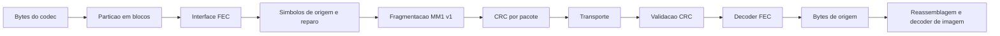

# Controle de erros e recuperacao

Este documento explica as tecnicas de integridade e recuperacao consideradas
para o MeshMedia Lab e separa explicitamente o que ja existe do que ainda e
proposta experimental.

| Item | Estado atual |
|---|---|
| CRC-16/CCITT-FALSE | Implementado por pacote |
| FEC | Nao implementado |
| Reed-Solomon | Nao implementado; candidato para experimento |
| Retransmissao seletiva | Nao implementada |

O estado completo de conformidade esta em
[`implementation-status.md`](implementation-status.md).

Os parametros de transmissao e o descritor inline atual (sem campos FEC)
estao em [`transmission-profile.md`](transmission-profile.md) e
[`transmission-descriptor.md`](transmission-descriptor.md). Os cenarios de
comparacao estao em [`experiment-matrix.md`](experiment-matrix.md).

## 1. Quatro conceitos diferentes

| Conceito | Pergunta respondida | Papel no projeto |
|---|---|---|
| CRC-16 | Os bytes recebidos provavelmente estao inteiros? | Detectar corrupcao |
| CCITT-FALSE | Qual parametrizacao do CRC-16 esta sendo usada? | Definir o algoritmo sem ambiguidade |
| FEC | Como adicionar redundancia para recuperar dados sem retorno? | Categoria de tecnicas |
| Reed-Solomon | Qual codigo pode gerar simbolos de reparo? | Candidato de FEC |

CRC detecta. Reed-Solomon pode recuperar. FEC e o conjunto de estrategias que
usa redundancia para corrigir ou recuperar. Os termos nao sao sinonimos.

## 2. Caminho implementado atualmente

```text
Imagem
  -> encoder grayscale ou RGB332
  -> descritor inline opcional (sem FEC)
  -> fragmentacao em payloads
  -> cabecalho + payload
  -> CRC-16/CCITT-FALSE
  -> transporte local UDP ou em memoria
  -> validacao do CRC
  -> reassemblagem quando todos os fragmentos existem
  -> decoder
```

O protocolo atual nao gera simbolos de reparo. Se um pacote for perdido, ou se
for corrompido e rejeitado pelo CRC, o `Reassembler` nao consegue concluir a
imagem.

## 3. CRC-16/CCITT-FALSE

CRC significa *Cyclic Redundancy Check*. Ele calcula um valor curto a partir de
uma sequencia de bytes. O receptor calcula o valor novamente e compara com o
valor recebido.

O CRC permite detectar muitos padroes de alteracao, mas nao reconstroi os bytes
originais. Tambem nao fornece autenticacao: um transmissor que consiga alterar
dados e recalcular o CRC nao e impedido por esse mecanismo.

### Parametros atuais

| Parametro | Valor |
|---|---|
| Width | 16 bits |
| Polynomial | `0x1021` |
| Init | `0xFFFF` |
| RefIn | `false` |
| RefOut | `false` |
| XorOut | `0x0000` |
| Check | `0x29B1` para `123456789` |
| Residue | `0x0000` |

No codigo, `crc16` esta em
[`protocol/crc.py`](../src/meshmedia_lab/protocol/crc.py). O `Packet` calcula o
CRC sobre `header + payload` e anexa o resultado como dois bytes em ordem de
rede. O receptor rejeita o pacote quando o valor nao confere. O vetor de
referencia e testado em
[`tests/unit/test_protocol.py`](../tests/unit/test_protocol.py).

### Por que documentar a tupla completa

O nome CCITT-FALSE e usado para identificar uma configuracao comum, mas nomes
de CRC podem ser usados de forma inconsistente. O polinomio, inicializacao,
reflexao e XOR final precisam ser registrados juntos. A implementacao nao deve
depender apenas do nome informal do algoritmo.

## 4. FEC

*Forward Error Correction* adiciona redundancia antes da transmissao. O
receptor usa a redundancia para recuperar dados sem solicitar o envio novamente.

FEC e uma categoria, nao um algoritmo unico. Exemplos incluem Hamming, BCH,
codigos convolucionais, LDPC, Polar e Reed-Solomon.

No MeshMedia Lab, FEC pode ser relevante quando o canal de retorno e caro, a
transmissao percorre varios saltos ou o custo de airtime de uma retransmissao e
maior que o custo de alguns simbolos de reparo. A redundancia, entretanto,
aumenta o numero de bytes e pode piorar a ocupacao do canal quando a perda e
baixa.

### 4.1 Interface abstrata proposta

A interface FEC deve ser independente do algoritmo. Ela pertence a uma camada
de laboratorio entre os dados codificados e a fragmentacao; nao deve obrigar o
protocolo a conhecer Reed-Solomon.

O contrato logico proposto e:

```text
FecEncoder.encode(source_block, config)
    -> EncodedBlock(source_symbols, repair_symbols, metadata)

FecDecoder.decode(received_symbols, erasures, config)
    -> DecodeResult(source_block, recovered_symbols, success, reason)
```

Os nomes acima sao contrato documental, nao API implementada.

#### Configuracao

`FecConfig` deve conter, no minimo:

| Campo | Significado |
|---|---|
| `algorithm_id` | Identifica o algoritmo sem acoplar a classe concreta |
| `symbol_size` | Tamanho fixo de cada simbolo em bytes |
| `data_symbols` (`k`) | Quantidade de simbolos de origem |
| `repair_symbols` (`r`) | Quantidade de simbolos de reparo |
| `block_symbols` (`n`) | Quantidade total transmitida; normalmente `k + r` |
| `interleaving_depth` | Profundidade de intercalacao, ou zero |
| `padding_policy` | Regra para completar o ultimo bloco |
| `incomplete_block_policy` | Regra para bloco menor que `k` |

Uma configuracao invalida deve falhar antes de codificar. Exemplos: simbolo
com tamanho zero, `k` zero, `r` negativo, `n` diferente de `k + r` quando o
algoritmo exigir essa relacao, ou bloco maior que os limites declarados.

#### Encoder

O encoder recebe um bloco de bytes de origem e produz simbolos de tamanho fixo.
O resultado deve distinguir:

- simbolos de origem, com indices `0..k-1`;
- simbolos de reparo, com indices `k..n-1`;
- bytes de padding adicionados ao ultimo bloco;
- metadados necessarios para remover o padding depois da recuperacao.

O encoder nao deve serializar pacotes MM1 nem calcular o CRC. A fragmentacao,
o envelope v1 e a integridade permanecem responsabilidades do protocolo.

#### Decoder

O decoder recebe simbolos identificados por indice e um conjunto de erasures
conhecidas. Um pacote ausente ou rejeitado pelo CRC pode entrar como erasure
quando o indice do simbolo for conhecido.

O resultado deve informar:

- se o bloco foi recuperado;
- bytes de origem, sem padding quando possivel;
- quantidade de simbolos recuperados;
- indices ausentes ou invalidos;
- motivo de falha quando houver dados insuficientes ou configuracao invalida.

O decoder nao deve tratar um simbolo corrompido como valido apenas porque a
posicao existe. Corrupcoes desconhecidas pertencem a um cenario separado do
experimento RS-only e precisam ser identificadas no resultado.

#### Blocos incompletos e limites

O comportamento do ultimo bloco deve ser escolhido por configuracao. As
alternativas sao rejeitar o bloco, preencher ate `k` simbolos ou usar uma
representacao explicita de comprimento. O valor adotado deve aparecer no
descritor e no registro do experimento quando FEC for integrado.

Um decoder nao pode prometer recuperacao fora dos limites do algoritmo. Para
Reed-Solomon, a referencia classica e `2e + s <= n-k`, onde `e` sao erros
desconhecidos e `s` sao erasures conhecidas. Esse limite e de simbolos, nao de
bits.

#### Separacao de camadas



A interface deve permitir Hamming, BCH, Reed-Solomon ou outro algoritmo no
futuro sem modificar o contrato do codec de imagem. Nenhuma implementacao FEC
ou classe de interface e criada nesta Etapa A.

### FEC, retransmissao e CRC

| Mecanismo | Recupera dados? | Precisa de retorno? | Custo principal |
|---|---:|---:|---|
| CRC | Nao | Nao | Bytes de integridade e descarte de pacotes invalidos |
| FEC | Pode recuperar | Nao | Redundancia, memoria e processamento |
| Retransmissao seletiva | Sim | Sim | ACK/NACK, tempo e airtime adicional |
| FEC + retransmissao | Sim | Opcional | Complexidade e custos combinados |

## 5. Reed-Solomon

Reed-Solomon e um codigo de bloco definido sobre um campo finito. Uma
configuracao `[n,k]` transforma `k` simbolos de dados em `n` simbolos
transmitidos. Os `n-k` simbolos adicionais sao simbolos de reparo.

Quando os simbolos sao elementos de `GF(2^8)`, cada elemento pode ser
representado por um byte. Isso nao significa que todo pacote tenha um byte de
payload: um simbolo de rede pode ser um vetor fixo de bytes, desde que o
algoritmo e o preenchimento sejam definidos.

Para `e` erros de simbolo desconhecidos e `s` erasures conhecidas, a condicao
classica e:

```text
2e + s <= n - k
```

Se somente existem erasures e as posicoes ausentes sao conhecidas, o limite e
`s <= n-k`. Em um codigo sistematico MDS, qualquer conjunto de `k` simbolos
validos pode recuperar o bloco de origem, desde que os simbolos invalidos ou
ausentes sejam identificados.

### Matriz experimental inicial

As configuracoes abaixo sao pontos de partida para medir o custo e a
recuperacao. Elas nao sao ainda uma escolha definitiva do protocolo.

| Codigo | Dados | Reparos | Taxa `k/n` | Erasures | Erros desconhecidos | Reparos/dados |
|---|---:|---:|---:|---:|---:|---:|
| RS(32,28) | 28 | 4 | 87,5% | 4 | 2 | 14,3% |
| RS(32,24) | 24 | 8 | 75,0% | 8 | 4 | 33,3% |
| RS(32,20) | 20 | 12 | 62,5% | 12 | 6 | 60,0% |

Os limites de erro da tabela sao limites de simbolos, nao necessariamente de
bits. A matriz deve ser repetida com uma definicao explicita de tamanho do
simbolo, tamanho do bloco, preenchimento e forma de transportar os simbolos.

O [RFC 5510](references.md#rfc5510) especifica esquemas Reed-Solomon para
canal de erasure e mostra a separacao entre simbolos de origem, simbolos de
reparo, tamanho do simbolo e bloco de origem. Esses conceitos sao referencia
para o experimento, nao uma afirmacao de que o MeshMedia Lab ja implementa o
RFC.

## 6. Camada candidata para o protocolo

Uma arquitetura candidata para um canal orientado a pacotes e:

```text
bytes codificados
  -> bloco de simbolos de origem
  -> Reed-Solomon
  -> simbolos de origem + reparo
  -> pacote individual com cabecalho e CRC
  -> canal
```

No receptor:

```text
pacote recebido
  -> validar CRC
  -> aceitar simbolo ou marcar erasure
  -> agrupar por bloco FEC
  -> decodificar Reed-Solomon
  -> reassemblar bytes de origem
```

Essa ordem e uma proposta de experimento. Ela trata um pacote perdido ou
rejeitado pelo CRC como uma erasure conhecida. Para isso, uma futura extensao do
cabecalho precisara identificar pelo menos o bloco FEC, o indice do simbolo, o
tamanho do bloco e a configuracao `k/n` ou um perfil equivalente.

O protocolo atual nao possui esses campos. A flag `FEC_PRESENT` do SDD e
conceitual e nao existe nas flags implementadas em `packet.py`. A flag `0x04`
identifica somente INLINE_DESCRIPTOR (ADR 0004), nunca FEC. O corpo v1 do
descritor nao transporta parametros FEC: sera necessaria revisao futura,
explicitamente aprovada, antes dessa integracao.

## 7. Plano de afericao

Cada configuracao deve ser comparada com uma mesma imagem, codec, resolucao,
quantizacao, tamanho de payload e semente de simulacao. A comparacao inicial
deve incluir:

- baseline sem FEC;
- RS(32,28), RS(32,24) e RS(32,20);
- perda aleatoria de 5%, 10%, 20% e 30%;
- perda em rajadas;
- corrupcao de pacotes separada de perda;
- posicoes de fragmentos ausentes conhecidas;
- retransmissao seletiva quando ela for implementada;
- combinacao de FEC e retransmissao quando ambas existirem.

As metricas obrigatorias sao:

| Metrica | Objetivo |
|---|---|
| Imagens reconstruidas | Medir sucesso fim a fim |
| Simbolos recuperados | Medir a capacidade do FEC |
| Bytes de origem | Medir dados uteis |
| Bytes de reparo | Medir redundancia |
| Bytes totais | Medir custo de transmissao |
| Numero de pacotes | Medir o impacto no transporte |
| Overhead de cabecalho e CRC | Separar custo de integridade |
| Airtime estimado | Medir ocupacao do canal |
| Tempo de codificacao | Medir custo no transmissor |
| Tempo de decodificacao | Medir custo no receptor |
| Memoria utilizada | Avaliar buffers necessarios |
| Latencia total | Avaliar experiencia de uso |
| Taxa de falha | Medir casos sem recuperacao |

Os experimentos devem registrar a semente, a configuracao completa e o numero
de repeticoes. Resultados sem esses dados nao devem ser tratados como
comparaveis.

O conjunto minimo de cenarios, payloads, dimensoes e ambientes esta detalhado
em [`experiment-matrix.md`](experiment-matrix.md). O modo RS-only descrito ali
e somente um harness controlado e nao um modo do MM1 v1.

## 8. Limites e decisoes em aberto

- O CRC atual detecta corrupcao, mas nao autentica o remetente.
- O tamanho de um simbolo RS ainda nao foi escolhido.
- Ainda nao foi decidido se o FEC atuara sobre bytes individuais, vetores de
  payload ou fragmentos completos.
- Ainda nao foi definido como os simbolos de reparo serao identificados no
  cabecalho.
- O impacto de perdas em rajada e intercalacao ainda precisa ser medido.
- O custo real de airtime depende do transporte MeshCore e nao do UDP local.
- Nenhuma configuracao RS deve ser chamada de recomendada para producao antes
  dos experimentos.

## Referencias

- [Reed e Solomon, 1960](references.md#rs60)
- [RFC 5510](references.md#rfc5510)
- [Hamming, 1950](references.md#hamming50)
- [Koopman e Chakravarty, 2004](references.md#koopman2004)
