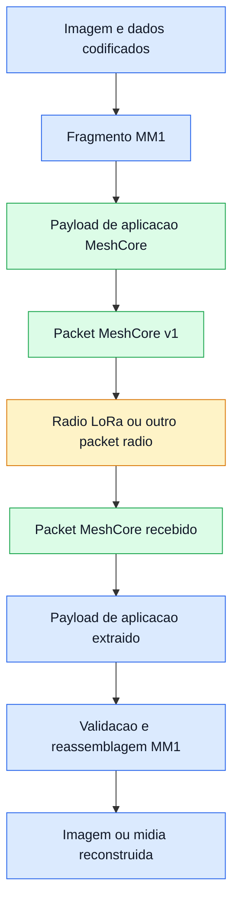
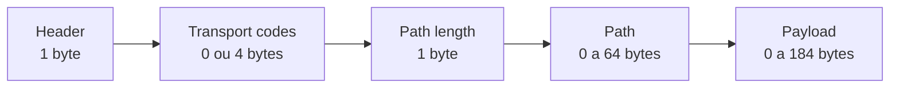
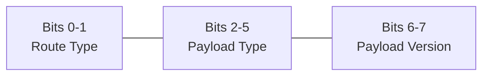

# Referencia MeshCore para o MM1

Este documento descreve a camada MeshCore que o MM1 pretende usar como
transporte. O MM1 nao substitui o formato de pacote MeshCore: ele precisa
encapsular seus fragmentos dentro de um tipo de payload que o MeshCore ja
conheca.

## Fontes e escopo

As fontes oficiais consultadas foram:

- [MeshCore Packet Format](https://github.com/meshcore-dev/MeshCore/blob/main/docs/packet_format.md)
- [MeshCore Payload Format](https://github.com/meshcore-dev/MeshCore/blob/main/docs/payloads.md)
- [`src/MeshCore.h`](https://github.com/meshcore-dev/MeshCore/blob/main/src/MeshCore.h)
- [`src/Packet.h`](https://github.com/meshcore-dev/MeshCore/blob/main/src/Packet.h)
- [`src/Packet.cpp`](https://github.com/meshcore-dev/MeshCore/blob/main/src/Packet.cpp)
- [MeshCore KISS Modem Protocol](https://github.com/meshcore-dev/MeshCore/blob/main/docs/kiss_modem_protocol.md)
- [MeshCore Radio Presets](https://github.com/meshcore-dev/MeshCore/blob/main/docs/radio_presets.md)

Os documentos upstream consultados descrevem o formato de pacote nivel 1 e
indicam o firmware v1.12.0 como referencia em `packet_format.md`. O branch
`main` do MeshCore continua evoluindo; por isso esta documentacao registra os
limites observados e aponta para as fontes originais, em vez de copiar uma
especificacao que pode ficar desatualizada.

## 1. Camadas: MM1 dentro do MeshCore



O pacote MM1 e uma camada interna. O MeshCore continua responsavel por rota,
path, deduplicacao, flooding, retransmissao de mesh e entrega do payload.

## 2. Formato de um pacote MeshCore v1

O formato bruto e:

```text
[header][transport_codes opcional][path_length][path][payload]
```



| Campo | Tamanho | O que carrega |
|---|---:|---|
| `header` | 1 byte | Rota, tipo do payload e versao do payload |
| `transport_codes` | 0 ou 4 bytes | Dois codigos de transporte de 16 bits, apenas em rotas `TRANSPORT_*` |
| `path_length` | 1 byte | Quantidade e tamanho dos hashes do caminho |
| `path` | 0 a 64 bytes | Hashes dos nos do caminho ou caminho acumulado em flooding |
| `payload` | 0 a 184 bytes | Dados interpretados pelo tipo indicado no header |

O tamanho efetivo do pacote no codigo MeshCore e:

```text
raw_length = 2 + path_bytes + payload_length + transport_codes_bytes
```

O `2` representa `header` e `path_length`. O codigo define:

| Constante | Valor | Fonte |
|---|---:|---|
| `MAX_PACKET_PAYLOAD` | 184 bytes | `src/MeshCore.h` |
| `MAX_PATH_SIZE` | 64 bytes | `src/MeshCore.h` |
| `MAX_TRANS_UNIT` | 255 bytes | `src/MeshCore.h` |

`MAX_TRANS_UNIT=255` e o limite do frame bruto aceito pelo transporte. O limite
de payload de 184 bytes nao significa que sempre existam 184 bytes disponiveis
para a aplicacao: `path`, `transport_codes` e o tipo de payload consomem parte
do frame.

Com o maior caminho valido e os codigos de transporte presentes, a soma dos
limites documentados chega a 254 bytes (`1 + 4 + 1 + 64 + 184`). O byte
restante do limite de 255 funciona como margem do MTU geral; a configuracao
real ainda precisa ser validada pelo firmware e pelo radio escolhido.

## 3. Header: rota, tipo e versao

O byte de header usa a forma `VVPPPPRR`:



| Bits | Campo | Valores |
|---|---|---|
| 0-1 | Route Type | `TRANSPORT_FLOOD`, `FLOOD`, `DIRECT`, `TRANSPORT_DIRECT` |
| 2-5 | Payload Type | Tipo semantico do pacote, de `0x00` a `0x0F` |
| 6-7 | Payload Version | Versao da estrutura interna do payload |

### Rotas

| Valor | Nome | Comportamento |
|---:|---|---|
| `0x00` | `ROUTE_TYPE_TRANSPORT_FLOOD` | Flooding com codigos de transporte |
| `0x01` | `ROUTE_TYPE_FLOOD` | Flooding; o caminho pode ser construido pelos nos |
| `0x02` | `ROUTE_TYPE_DIRECT` | Rota direta usando o path fornecido |
| `0x03` | `ROUTE_TYPE_TRANSPORT_DIRECT` | Rota direta com codigos de transporte |

### Path

`path_length` nao e simplesmente um tamanho em bytes:

| Bits | Campo | Valores |
|---|---|---|
| 0-5 | Quantidade de hashes | 0 a 63 saltos |
| 6-7 | Codigo de tamanho do hash | 1, 2 ou 3 bytes; `0b11` reservado |

O tamanho real e:

```text
path_bytes = hash_count * hash_size
```

Exemplos:

| `path_length` | Hashes | Bytes de path |
|---:|---:|---:|
| `0x00` | 0 hashes de 1 byte | 0 |
| `0x05` | 5 hashes de 1 byte | 5 |
| `0x45` | 5 hashes de 2 bytes | 10 |
| `0x8A` | 10 hashes de 3 bytes | 30 |

O MM1 nao deve tentar usar `path_length` como se fosse um campo de fragmentacao
proprio. Ele pertence ao roteamento MeshCore e e mantido pelo transporte.

## 4. Tipos de payload MeshCore

O campo `Payload Type` define o que o firmware espera encontrar em `payload`.

| Valor | Tipo | O que o payload carrega |
|---:|---|---|
| `0x00` | `REQ` | Hash de destino, hash de origem, MAC e dados criptografados |
| `0x01` | `RESPONSE` | Resposta a `REQ` ou `ANON_REQ` |
| `0x02` | `TXT_MSG` | Mensagem de texto ponto a ponto |
| `0x03` | `ACK` | Confirmacao simples |
| `0x04` | `ADVERT` | Identidade, timestamp, assinatura e dados de anuncio |
| `0x05` | `GRP_TXT` | Mensagem de texto de grupo, sem identidade verificada |
| `0x06` | `GRP_DATA` | Datagrama binario de grupo |
| `0x07` | `ANON_REQ` | Hash de destino, chave publica efemera, MAC e dados |
| `0x08` | `PATH` | Caminho retornado e payload extra opcional |
| `0x09` | `TRACE` | Rastreamento de caminho e SNR por salto |
| `0x0A` | `MULTIPART` | Parte de uma sequencia de pacotes |
| `0x0B` | `CONTROL` | Dados de controle normalmente nao criptografados |
| `0x0F` | `RAW_CUSTOM` | Bytes customizados, sem formato imposto pelo MeshCore |

Os valores `0x0C`, `0x0D` e `0x0E` permanecem reservados. Todos os inteiros de
16 e 32 bits dos payloads MeshCore sao little-endian, salvo indicacao contraria
na documentacao upstream.

## 5. Payloads relevantes para o MM1

### 5.1 `PAYLOAD_TYPE_GRP_DATA`

O datagrama binario de grupo e a opcao mais natural para uma aplicacao que
precisa participar de um canal MeshCore:


No lado interno, o payload de grupo contem:

| Campo | Tamanho | Funcao |
|---|---:|---|
| `channel_hash` | 1 byte | Identifica o canal por hash |
| `cipher MAC` | 2 bytes | Verifica o bloco criptografado |
| `ciphertext` | Variavel | Dados preenchidos e criptografados |

Depois da descriptografia, o datagrama possui `data_type` de 16 bits, `data_len`
de 1 byte e os dados da aplicacao. O firmware nao interpreta o conteudo do
`data_type`: ele identifica a aplicacao responsavel pelo formato interno.

O MeshCore define `MAX_GROUP_DATA_LENGTH = 165` bytes para o campo de dados da
aplicacao enviado por `CMD_SEND_CHANNEL_DATA`. O `data_type` fica fora desse
campo no comando do companion e e inserido no envelope de grupo pelo MeshCore.
Mesmo assim, o envelope interno reserva 2 bytes para `data_type` e 1 byte para
`data_len`, alem do hash, MAC, preenchimento e criptografia. O adaptador MM1
deve usar 165 bytes como limite conservador da carga de aplicacao e validar o
firmware exato antes de aumentar esse valor.

### 5.2 `PAYLOAD_TYPE_RAW_CUSTOM`

`RAW_CUSTOM` deixa o payload sem uma estrutura definida pelo MeshCore. Ele pode
transportar bytes de uma aplicacao que fornece sua propria criptografia e
formato.

Na implementacao MeshCore consultada, o recebimento de `RAW_CUSTOM` e tratado
para rota direta. Portanto, ele nao deve ser escolhido automaticamente como
substituto de `GRP_DATA`: flooding, seguranca, identificacao da aplicacao e
controle de duplicatas precisam ser definidos separadamente.

### 5.3 Outros payloads

O [documento oficial de payloads](https://github.com/meshcore-dev/MeshCore/blob/main/docs/payloads.md)
detalha os campos de cada tipo. Alguns tamanhos importantes sao:

| Tipo | Campos principais |
|---|---|
| `ADVERT` | Chave publica de 32 bytes, timestamp de 4 bytes, assinatura Ed25519 de 64 bytes e appdata opcional |
| `ACK` | Checksum de 4 bytes |
| Dados ponto a ponto | Hash destino de 1 byte, hash origem de 1 byte, MAC de 2 bytes e ciphertext |
| Texto simples | Timestamp de 4 bytes, tipo/tentativa de 1 byte e texto |
| `CONTROL` | Flags de subtipo e dados de controle |
| `MULTIPART` | Tipo original e contador de partes restantes |

Esses formatos sao do MeshCore. O MM1 deve permanecer dentro de um campo de
dados de aplicacao, sem reutilizar `PAYLOAD_TYPE_TXT_MSG` para transportar bytes
binarios.

## 6. Tamanho efetivo para o MM1

O MM1 atual serializa cada pacote assim:

```text
MM1 packet = MM1 header (19) + MM1 payload (P) + MM1 CRC (2)
           = P + 21 bytes
```

Como o `Fragmenter` atual aceita payload de ate 255 bytes, o pacote MM1 local
pode chegar a 276 bytes. Isso funciona no UDP de laboratorio, mas nao cabe no
MTU MeshCore.

### Opcao A: MM1 dentro de `GRP_DATA`

Para usar a carga de aplicacao de ate 165 bytes:

```text
P + 21 <= 165
P <= 144 bytes
```

O payload padrao atual do MM1 e 64 bytes, produzindo um pacote MM1 de 85 bytes,
portanto cabe nessa opcao. Um payload MM1 de 144 bytes e o maior valor teorico
antes de considerar outras politicas do adaptador.

### Opcao B: MM1 dentro de `RAW_CUSTOM`

Se o transporte direto customizado aceitar os 184 bytes do payload MeshCore:

```text
P + 21 <= 184
P <= 163 bytes
```

Esse limite nao e uma decisao do MM1. Ele depende da rota, do firmware, da
forma de entrega e da seguranca escolhida. A opcao `RAW_CUSTOM` permanece em
avaliacao.

### Regra de implementacao futura

O adaptador MeshCore nao deve reutilizar cegamente o limite `255` do
`Fragmenter`. Ele deve receber o limite efetivo da camada externa e rejeitar ou
fragmentar uma carga que exceda esse limite antes de criar o pacote MeshCore.

## 7. Airtime e tamanho

Tamanho de pacote e airtime sao metricas diferentes. O airtime depende, entre
outros fatores, da frequencia, bandwidth, spreading factor, coding rate,
configuracao do radio e tamanho do frame.


O MeshCore possui uma operacao de estimativa de airtime no KISS Modem Protocol:
`GetAirtime` (`0x0F`), que recebe o tamanho do pacote e retorna milissegundos.
No firmware, o `Dispatcher` tambem chama `getEstAirtimeFor(len)` e mantém um
orcamento de transmissao.

Para cada experimento MM1, registrar pelo menos:

- tamanho do pacote MM1;
- tamanho bruto do pacote MeshCore;
- quantidade de pacotes MeshCore;
- parametros do radio;
- airtime estimado por pacote;
- airtime total;
- quantidade de saltos e tipo de rota;
- perdas, duplicatas e retransmissoes observadas.

Os presets de radio do MeshCore sao sugestoes configuraveis e dependem da regiao
e da regulamentacao local. Eles nao devem ser tratados como uma configuracao
universal do MM1.

## 8. Decisao ainda em aberto

O MM1 ainda nao escolheu o envelope MeshCore para transportar os pacotes MM1.
O fato de o destino ser um canal privado deve ser considerado junto com a
seguranca e a semantica de cada tipo de payload.

| Opcao | Vantagem | Custo ou risco |
|---|---|---|
| `GRP_DATA` | Usa canal, criptografia e entrega de grupo existentes | Limite efetivo de aplicacao menor e envelope adicional |
| `TXT_MSG` | Pode reutilizar uma interface de mensagem existente | E textual; imagem binaria exigiria hex/base64 ou outra codificacao, aumentando muito o overhead e mudando a semantica |
| `RAW_CUSTOM` | Mais bytes livres e formato proprio | Rota direta, seguranca e duplicacao ficam sob responsabilidade da aplicacao |
| Pacote MeshCore customizado | Controle total do formato | Exige mudancas ou extensoes no firmware MeshCore |

`GRP_DATA` e o candidato a priorizar para uma imagem binaria em canal privado,
porque o tipo foi desenhado para dados de grupo e o MeshCore ja fornece o
envelope de canal, criptografia e MAC. Isso ainda nao e uma decisao aprovada.
O MM1 nao deve colocar a chave do canal, chave privada ou material criptografico
em seu proprio payload; o adaptador deve usar a configuracao segura do MeshCore.

`TXT_MSG` nao deve ser usado como primeira opcao para a imagem. Alem do custo de
converter bytes para texto, seria necessario confirmar se a rota, a entrega e a
criptografia de mensagens de texto preservam as propriedades desejadas para um
datagrama binario fragmentado.

O proximo experimento de transporte deve comparar pelo menos `GRP_DATA` e
`RAW_CUSTOM`, e documentar `TXT_MSG` como controle somente se houver uma razao
operacional para avalia-lo. O teste deve usar um firmware MeshCore identificado,
um canal privado com chave configurada fora do MM1, e medir sucesso, tamanho,
airtime, autenticacao, duplicatas, flooding e rota direta.

## Referencias locais

- [Controle de erros do MM1](error-control.md)
- [Status de implementacao](implementation-status.md)
- [Arquitetura do laboratorio](architecture.md)
