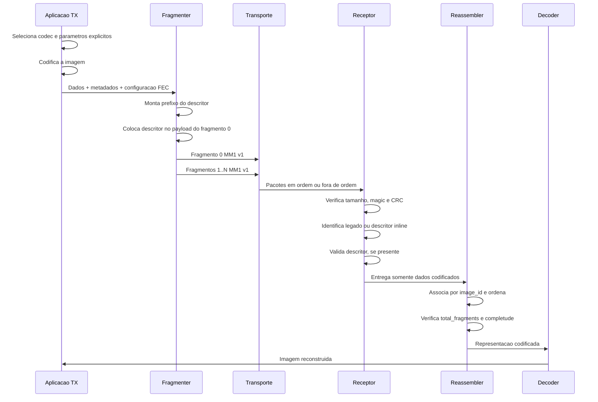
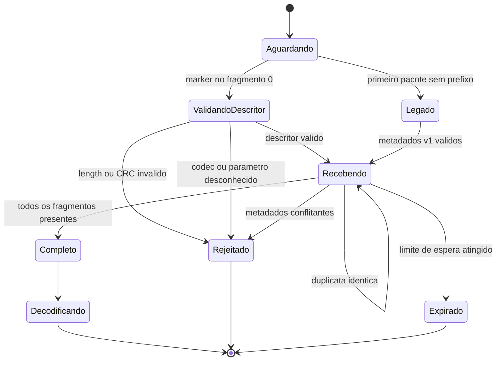

# Transmission Descriptor no MM1 v1

Este documento especifica a proposta de um descritor compacto embutido no
primeiro fragmento de uma transmissao MM1 v1. O descritor orienta o receptor
sem criar uma mensagem adicional e sem alterar o cabecalho v1 de 19 bytes.

**Estado:** proposto; nao implementado.

## 1. Objetivo

O receptor deve conseguir decidir como interpretar os dados sem receber uma
configuracao escondida por outro canal. O descritor informa os parametros que
nao podem ser inferidos com seguranca, mas evita repetir no payload campos que
ja existem no cabecalho de cada pacote v1.

O descritor nao e um pacote separado. Ele e um prefixo do payload do primeiro
fragmento:

```text
Pacote 0:
  [header MM1 v1][marker][descriptor_length][descriptor_body][data_0][CRC]

Pacotes 1..N:
  [header MM1 v1][data_i][CRC]
```

O primeiro fragmento continua sendo identificado por `FLAG_FIRST_FRAGMENT`.
Os bytes do descritor fazem parte do payload protegido pelo CRC daquele pacote.

## 2. Formato v1 que nao muda

O envelope implementado continua sendo:

```text
offset  tamanho  campo
0       2        magic = "MM"
2       1        protocol_version
3       1        media_type
4       1        codec
5       1        flags
6       2        image_id / transmission_id
8       2        fragment_number
10      2        total_fragments
12      2        width
14      2        height
16      2        levels
18      1        payload_length
19      P        payload
19 + P  2        CRC-16/CCITT-FALSE
```

Todos os inteiros do pacote MM1 v1 usam ordem de rede (big-endian). O CRC e
calculado sobre os 19 bytes do cabecalho e os `P` bytes de payload. O pacote
completo tem `P + 21` bytes.

O descritor nao repete estes campos do cabecalho:

- `image_id`, que associa a transmissao;
- `fragment_number` e `total_fragments`;
- `media_type`;
- `codec`;
- `width` e `height`;
- `levels` quando o codec grayscale usa o campo atual.

Essa escolha reduz o tamanho do prefixo e evita uma segunda fonte de verdade.

## 3. Prefixo do descritor

A codificacao abaixo e uma proposta para revisao humana. Ela define a
estrutura necessaria sem aprovar valores finais para o wire format.

```text
descriptor_prefix = marker | descriptor_length | descriptor_body
```

| Campo | Tamanho candidato | Regra |
|---|---:|---|
| `marker` | 2 bytes | Sequencia reservada para distinguir o prefixo de dados |
| `descriptor_length` | 1 byte | Tamanho de `descriptor_body`, sem marker e sem o proprio length |
| `descriptor_body` | 0..255 bytes | Campos versionados e compactos |

Um marcador de dois bytes reduz a chance de uma transmissao legada iniciar
casualmente com uma sequencia reconhecida. O receptor deve tambem validar o
comprimento, a versao e os campos antes de aceitar o modo com descritor.

O valor concreto de `marker`, a versao inicial do descritor e a codificacao
final do corpo continuam pendentes de revisao. Nao se deve inferir um
descritor apenas porque os primeiros bytes do payload parecem validos.

Uma alternativa de codificacao do corpo e usar uma mascara de presenca seguida
somente dos campos necessarios. Isso reduz o caso baseline sem FEC e permite
adicionar parametros depois sem enviar zeros para campos ausentes. TLVs sao
outra alternativa, com mais overhead e maior flexibilidade. A escolha deve
considerar o limite de payload e vetores de compatibilidade.

## 4. Campos logicos do corpo

Os campos abaixo precisam ser representados pela proposta, mas podem ser
omitidos quando forem derivados do cabecalho ou quando o valor default for
`NONE` explicitamente documentado.

| Campo logico | Tipo candidato | Quando enviar |
|---|---|---|
| `descriptor_version` | `uint8` | Sempre no modo com descritor |
| `descriptor_flags` | `uint8` | Sempre; indica campos opcionais |
| `compression_id` | `uint8` | Quando diferente de `NONE` |
| `encoded_length` | `uint16` | Quando o tamanho nao for derivavel |
| `fec_algorithm` | `uint8` | Sempre que o modo FEC for descrito |
| `symbol_size` | `uint16` | Quando FEC estiver habilitado |
| `data_symbols` (`k`) | `uint16` | Quando FEC estiver habilitado |
| `repair_symbols` (`r`) | `uint16` | Quando FEC estiver habilitado |
| `block_symbols` | `uint16` | Quando nao for `k + r` |
| `interleaving_depth` | `uint16` | Quando interleaving estiver habilitado |
| `padding_policy` | `uint8` | Quando houver preenchimento definido |
| `incomplete_block_policy` | `uint8` | Quando houver ultimo bloco parcial |

Para grayscale packed sem compressao e sem FEC, o tamanho dos dados pode ser
calculado por:

```text
ceil(width * height * log2(levels) / 8)
```

Nesse caso, `encoded_length`, `compression_id` e todos os campos FEC podem ser
omitidos, desde que o modo baseline esteja explicitamente identificado.

Para RGB332 sem compressao, o tamanho derivavel e `width * height`. O codec
`0x02` e implementado no envelope v1 com `levels=0`; o descritor continua
desnecessario para os parametros fixos `3/3/2`.

O descritor nunca deve conter um ID de perfil que esconda esses parametros.
Uma configuracao experimental deve ser reproduzivel a partir dos valores
transmitidos e registrados no experimento.

## 5. Sequencia de transmissao



O descritor nao cria um novo contador de mensagens. O contador continua sendo
`total_fragments`. O custo real e medido em bytes: o primeiro fragmento possui
menos bytes de imagem e pode provocar um fragmento adicional se o payload
estiver no limite.

## 6. Ciclo de vida no receptor



### 6.1 Primeiro fragmento ausente

No modo com descritor, os fragmentos posteriores podem chegar antes do
fragmento 0. O receptor pode armazenar esses fragmentos em uma fila limitada,
indexada por `image_id`, `total_fragments` e metadados v1. Ele nao deve
decodificar nem aplicar uma configuracao FEC enquanto o descritor estiver
ausente. Ao atingir o limite de memoria ou timeout, a transmissao e descartada.

O tamanho da fila e o timeout sao politicas locais, nao campos do wire format.

### 6.2 Duplicatas

- Descritor identico para o mesmo `image_id`: aceitar sem substituir o estado.
- Descritor diferente para o mesmo `image_id`: rejeitar a transmissao.
- Fragmento identico: ignorar a repeticao.
- Fragmento com mesmo numero e payload diferente: rejeitar a transmissao.

### 6.3 Erros

- Pacote menor que o cabecalho e CRC: descartar.
- Magic, tamanho ou CRC invalidos: descartar.
- `descriptor_length` maior que o payload disponivel: rejeitar o descritor.
- Codec, compressao ou FEC desconhecidos: rejeitar o modo com descritor.
- CRC invalido nao e corrigido pelo receptor atual.
- Sem FEC implementado, uma perda ou descarte deixa a transmissao incompleta.

## 7. Compatibilidade

Existem dois modos deliberadamente diferentes dentro do ecossistema MM1 v1:

| Modo | Primeiro payload | Receptor legado |
|---|---|---|
| V1 legado | Dados codificados | Compativel com o baseline |
| V1 com descritor | Prefixo + dados codificados | Nao interpreta corretamente o prefixo |

O protocolo v1 e mantido porque o cabecalho, o CRC e o modo legado nao mudam.
Entretanto, a extensao com descritor nao e transparente para um receptor que
nao a conhece. O transmissor deve selecionar o modo de acordo com a capacidade
do receptor; nao ha negociacao automatica implementada nesta etapa.

Nao e permitido:

- alterar o significado de `FLAG_FIRST_FRAGMENT` ou `FLAG_LAST_FRAGMENT`;
- usar uma flag reservada como se fosse o marcador sem uma decisao registrada;
- remover `width`, `height`, `levels` ou outros campos do cabecalho v1;
- chamar a extensao de v2;
- marcar a extensao como implementada antes de haver codigo e testes.

## 8. Relacao com o FEC

O descritor pode anunciar uma configuracao FEC futura, mas nao implementa FEC.
Uma implementacao posterior precisara definir como `fragment_number` mapeia
para bloco e simbolo, ou propor campos adicionais dentro da extensao. O
`Reassembler` atual somente concatena payloads e exige todos os fragmentos.

O CRC continua sendo validado antes de um futuro decoder FEC. Um pacote
rejeitado pelo CRC pode ser uma erasure conhecida, mas isso so tera efeito
quando existir uma implementacao FEC.

## 9. Vetores de exemplo conceituais

### V1 legado

```text
fragment 0 payload = encoded_data[0:P]
fragment 1 payload = encoded_data[P:2P]
```

### V1 com descritor

```text
fragment 0 payload = marker | length | descriptor_body | encoded_data[0:P-D]
fragment 1 payload = encoded_data[P-D:P-D+P]
```

`D` inclui marker, length e body. O calculo final precisa considerar o ultimo
fragmento e o `total_fragments` produzido pelo fragmenter.
