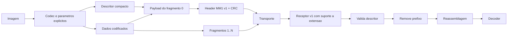

# Perfil de transmissao MM1 v1

Este documento define os parametros explicitos de uma transmissao de imagem e
separa o formato MM1 v1 atualmente implementado da extensao de descritor inline
proposta para a Etapa A.

**Estado:** proposta de especificacao; nenhuma alteracao binaria foi
implementada nesta etapa.

## 1. Escopo e estados

O perfil nao e um catalogo de presets. O transmissor deve informar ou registrar
os valores efetivamente usados em cada transmissao e experimento.

| Item | Estado |
|---|---|
| MM1 v1 sem descritor | Implementado como baseline local |
| Grayscale packed | Implementado com codec `0x01` |
| Limite de 128 x 128 | Implementado no grayscale; nao inclui tiling |
| Descritor inline no primeiro fragmento | Proposto como extensao v1 |
| RGB332 | Proposto; nao implementado |
| FEC parametrizavel | Proposto; nao implementado |
| Perfis nomeados ou presets | Futuro; fora desta etapa |

O protocolo continua sendo MM1 v1. O descritor nao cria uma v2 e nao altera o
cabecalho v1 existente. Ele e uma extensao opcional que exige um receptor capaz
de interpretar o primeiro payload no modo com descritor.

## 2. Parametros da transmissao

Os parametros abaixo formam o perfil logico de uma transmissao. Os tamanhos da
tabela sao tipos candidatos para a extensao; no pacote v1 legado, os tamanhos
efetivos sao os definidos pelo cabecalho existente em
`src/meshmedia_lab/protocol/packet.py`.

| Parametro | Tipo logico | Regra inicial | Situacao |
|---|---|---|---|
| `transmission_id` (`image_id` no v1) | `uint16` | `0..65535` | Implementado |
| `media_type` | `uint8` | `0x01 = IMAGE` | Implementado |
| `codec_id` | `uint8` | Registro de codecs | Parcial |
| `width` | `uint16` no v1 | `1..128`, independente de `height` | Limite proposto |
| `height` | `uint16` no v1 | `1..128`, independente de `width` | Limite proposto |
| `codec_parameters` | bytes versionados | Sem valores implícitos | Proposto |
| `encoded_length` | `uint16` candidato | Obrigatorio quando nao for derivavel | Proposto |
| `total_fragments` | `uint16` | Pelo menos 1 | Implementado no v1 |
| `payload_limit` | `uint8` no v1 | `1..255` local; limite externo pode ser menor | Implementado |
| `compression_id` | `uint8` candidato | `NONE` no baseline | Proposto |
| `fec_config` | estrutura explicita | Sem FEC no baseline | Proposto |

`width` e `height` nao formam uma proporcao obrigatoria. Imagens retangulares
sao validas. A area maxima inicial e, portanto, `128 x 128`; nao ha tiling nem
composicao automatica de imagens maiores nesta fase.

O limite de 128 pixels e aplicado independentemente a largura e a altura por
`ImageMetadata`, `ImageEncoder` e `EncodedImage`. Dimensoes maiores sao
rejeitadas antes de criar ou aceitar uma representacao grayscale. A regra nao
introduz tiling nem altera os campos de duas bytes do cabecalho MM1 v1.

## 3. Registro de codecs

### 3.1 Grayscale packed

| Campo | Valor |
|---|---|
| `codec_id` | `0x01` |
| Entrada | Matriz de pixels grayscale de 8 bits |
| Ordem | Row-major, da primeira linha para a ultima |
| Quantizacao | `q = floor(pixel * levels / 256)` |
| Niveis | `2`, `4`, `8`, `16` ou `256` no encoder atual |
| Empacotamento | Bits mais significativos primeiro dentro do fluxo |
| Padding final | Bits restantes preenchidos com zero |
| Compressao | Nenhuma; RLE nao esta ativo |
| Tamanho derivavel | `ceil(width * height * log2(levels) / 8)` bytes |

O valor quantizado ocupa `log2(levels)` bits por pixel. O decoder atual
reconstroi os valores para a escala `0..255` usando os niveis recebidos.

Para este codec, `width`, `height` e `levels` ja estao no cabecalho v1 atual.
Um descritor inline nao deve repeti-los. `encoded_length` pode ser omitido
quando o calculo acima for suficiente.

O identificador `0x01` e parte do baseline implementado. A lista exata de
niveis aceitos pelo perfil deve permanecer alinhada com o encoder quando a
validacao de 128 x 128 for implementada.

### 3.2 RGB332

Esta e uma proposta para revisao, nao uma capacidade disponivel.

| Campo | Proposta |
|---|---|
| `codec_id` | `0x02` candidato |
| Tamanho | 1 byte por pixel |
| Ordem dos bits | `RRRGGGBB` |
| Ordem dos canais | Vermelho, verde, azul |
| Ordem dos pixels | Row-major |
| Alpha | Nao presente |
| Tamanho derivavel | `width * height` bytes |
| Compressao | Nenhuma nesta etapa |

O identificador, a ordem dos bits e a politica de reconstrucao sao propostas
pendentes de revisao humana. RGB332 nao deve ser adicionado ao registro de
codecs implementado antes de existirem encoder, decoder e testes de round-trip.

## 4. Controle de compressao

Codec, empacotamento e compressao sao conceitos separados.

| `compression_id` candidato | Significado | Estado |
|---:|---|---|
| `0x00` | Nenhuma compressao | Baseline atual |
| `0x01` | RLE | Futuro; nao implementado |

Um receptor nao deve inferir RLE apenas pelo tamanho do payload. Quando uma
compressao for introduzida, ela devera ser identificada explicitamente e ter
parametros documentados.

## 5. FEC no perfil

O perfil reserva uma configuracao explicita para controle de erros, mas nao
habilita FEC no MM1 v1 atual.

| Campo | Tipo candidato | Regra |
|---|---|---|
| `fec_algorithm` | `uint8` | `0x00 = NONE`; outros valores exigem suporte anunciado |
| `symbol_size` | `uint16` | Tamanho em bytes de um simbolo |
| `data_symbols` (`k`) | `uint16` | Simbolos de origem por bloco |
| `repair_symbols` (`r`) | `uint16` | Simbolos de reparo por bloco |
| `block_symbols` | `uint16` | Normalmente `k + r` |
| `interleaving_depth` | `uint16` | `0` quando desabilitado |
| `padding_policy` | `uint8` | Regra explicita para o ultimo bloco |
| `incomplete_block_policy` | `uint8` | Regra para blocos incompletos |

Quando `fec_algorithm = NONE`, os demais campos devem ser zero ou omitidos,
conforme a codificacao do descritor aprovada. Reed-Solomon e o primeiro
candidato experimental, mas nenhum parametro RS e uma recomendacao de
producao.

CRC e FEC continuam sendo camadas diferentes:

- CRC detecta corrupcao no pacote e pode fazer o pacote ser tratado como
  erasure por um futuro decoder FEC.
- FEC adiciona redundancia e pode recuperar dados dentro de seus limites.
- Desabilitar CRC para o experimento RS-only nao altera o MM1 v1; esse modo
  pertence apenas ao harness controlado dos benchmarks.

## 6. Limites de payload e contagem de mensagens

O campo `payload_length` v1 tem um byte e o `Fragmenter` local aceita ate 255
bytes. Isso nao e o limite do transporte MeshCore.

Para `GRP_DATA`, a referencia atual usa 165 bytes de dados de aplicacao. Como
um pacote MM1 v1 ocupa `P + 19 + 2`, o limite conservador e:

```text
P + 21 <= 165
P <= 144
```

O valor padrao local e `P=64`.

No modo com descritor, o primeiro payload e dividido entre a extensao e os
dados. Se `D` for o tamanho do prefixo do descritor:

```text
dados_no_primeiro_fragmento <= payload_limit - D
```

O descritor deve ser curto o bastante para nao criar um fragmento extra na
maioria dos casos. O numero de mensagens, entretanto, deve ser calculado com o
descritor incluido e medido separadamente do numero de bytes uteis.

## 7. Modos de transmissao

### Modo legado

O payload do primeiro fragmento inicia diretamente com dados codificados.
Todos os pacotes seguem o formato implementado atualmente.

### Modo com descritor inline

O primeiro fragmento inicia com um marcador, um comprimento e o corpo do
descritor. O restante do payload contem dados codificados. Os fragmentos
seguintes continuam usando o envelope v1 atual.



O modo com descritor e uma extensao proposta do v1. Um receptor legado nao
conhece o prefixo e nao pode ser considerado compativel com esse modo. O modo
legado permanece disponivel e nao sofre alteracao de bytes.

## 8. Valores desconhecidos e compatibilidade

- Um codec desconhecido deve ser rejeitado antes da decodificacao.
- Um algoritmo FEC desconhecido deve impedir o modo FEC, sem ser tratado como
  `NONE`.
- Parametros fora dos limites devem invalidar a transmissao.
- A versao do descritor deve ser validada separadamente da versao do protocolo.
- O valor `1` do protocolo continua identificando MM1 v1.
- Nenhum campo existente pode ganhar novo significado sem uma decisao de
  extensao registrada e testes de vetores binarios.
- Uma mudanca que remova metadados do cabecalho atual nao pertence a esta
  extensao e exigiria uma decisao de compatibilidade posterior.

## 9. O que nao e um perfil nesta etapa

Nao sao perfis aprovados:

- `32x32 grayscale 16 levels`;
- RS(32,28), RS(32,24) ou RS(32,20);
- qualquer combinacao de payload, codec e FEC chamada de recomendada;
- parametros do radio MeshCore;
- uma configuracao de airtime.

Esses valores podem ser cenarios de experimento, mas a transmissao deve
registrar cada parametro explicitamente.
