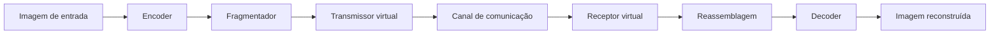
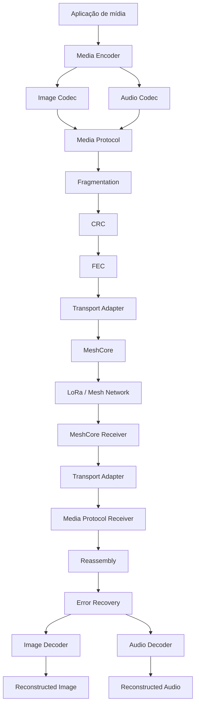

# MeshMedia Lab
## MM1 — MeshMedia v1: protocolo experimental de transmissão de imagens e áudio sobre redes MeshCore

- **Status:** Proposta inicial / fase de exploração
- **Abordagem:** Specification-Driven Development (SDD)
- **Objetivo:** Desenvolver um protocolo eficiente para transmissão de imagens e, futuramente, áudio através de redes MeshCore/LoRa.
- **Nome do protocolo:** MM1 (MeshMedia v1)
- **Revisão do SDD:** 0.2.0-draft
- **Versão da implementação de referência:** 0.1.0
- **Versão do protocolo binário:** 1
- **Conformidade:** Parcial
- **Matriz de implementação:** [`docs/implementation-status.md`](../docs/implementation-status.md)
- **Documentação de controle de erros:** [`docs/error-control.md`](../docs/error-control.md)

# 0. Versionamento e conformidade

O SDD e uma especificacao de evolucao. Ele pode registrar uma capacidade
proposta antes que exista codigo, mas cada capacidade deve declarar seu estado
de implementacao na [matriz de rastreabilidade](../docs/implementation-status.md).

O projeto usa tres identificadores independentes:

| Identificador | Funcao |
|---|---|
| Versao do software | Evolucao do pacote Python e de sua API. Atualmente `0.1.0`. |
| Versao do protocolo | Compatibilidade do formato binario transportado. Atualmente `1`. |
| Revisao do SDD | Evolucao dos requisitos, decisoes e propostas. Atualmente `0.2.0-draft`. |

Uma alteracao editorial nao altera a versao do software nem a versao do
protocolo. Uma alteracao incompativel no formato ou no significado dos pacotes
exige uma nova versao do protocolo. A versao do SDD pode avancar antes do
software, desde que a diferenca esteja registrada na matriz.

Os termos usados neste documento sao:

- **Implementado:** codigo, testes e documentacao estao coerentes.
- **Parcial:** existe codigo, mas parte do requisito ainda falta.
- **Proposto:** existe um desenho tecnico, mas nao existe implementacao.
- **Planejado:** trabalho futuro ainda sem desenho fechado.

---

# 1. Contexto e motivação

Redes baseadas em LoRa, como MeshCore, possuem limitações significativas de largura de banda, payload, airtime e capacidade de transmissão.

A transmissão de arquivos convencionais, como fotografias JPEG ou arquivos de áudio, pode ser impraticável devido ao volume de dados envolvidos.

Entretanto, podemos explorar técnicas de representação, compressão e codificação de informação para transmitir uma representação simplificada de imagens e áudio.

A ideia é desenvolver um protocolo especializado de mídia, inspirado em conceitos utilizados pelo SSTV (Slow Scan Television), mas adaptado para comunicação digital por pacotes em uma rede Mesh.

O objetivo não é reproduzir literalmente o SSTV analógico.

Queremos aproveitar sua filosofia:

> Sacrificar qualidade, resolução e velocidade para transmitir uma representação visual útil através de um canal de comunicação extremamente limitado.

---

# 2. Conceito geral

O projeto pretende desenvolver um sistema capaz de:

- Capturar ou selecionar uma imagem.
- Redimensionar a imagem.
- Reduzir sua profundidade de cor.
- Aplicar técnicas de compressão.
- Codificar a imagem em um formato otimizado para transmissão.
- Fragmentar os dados em pequenos pacotes.
- Transmitir os pacotes através de um canal de comunicação.
- Detectar corrupção de dados.
- Detectar fragmentos ausentes.
- Recuperar dados perdidos, quando possível.
- Reassemblar os fragmentos.
- Decodificar a imagem.
- Reconstruir a imagem no receptor.

Em uma fase futura, a mesma arquitetura poderá ser adaptada para transmissão de áudio.

---

# 3. Inspiração: SSTV

Um colega desenvolveu um protótipo não aberto que utiliza uma abordagem semelhante ao SSTV.

O SSTV tradicional transforma uma imagem em um sinal transmitido sequencialmente, permitindo que o receptor reconstrua a imagem progressivamente.

Nossa proposta é adaptar essa filosofia ao transporte digital por pacotes.

Em vez de gerar necessariamente um sinal de áudio SSTV, poderemos representar a imagem como uma sequência de dados binários, organizados em linhas, blocos ou fragmentos.

O protocolo deverá considerar:

- Representação da imagem.
- Codificação das linhas.
- Sincronização.
- Identificação da transmissão.
- Fragmentação.
- Reconstrução progressiva.
- Compressão.
- Detecção de erros.
- Recuperação de dados.
- Eficiência do payload.

---

# 4. Possíveis abordagens para codificação de imagens

## 4.1 JPEG em resolução extremamente reduzida

Uma abordagem inicial seria redimensionar a imagem e gerar um JPEG de qualidade extremamente baixa.

Vantagens:

- Implementação simples.
- Codec conhecido.
- Fácil comparação.
- Compatibilidade com ferramentas existentes.

Desvantagens:

- JPEG pode não ser eficiente para imagens muito pequenas.
- Possui overhead.
- A estrutura do arquivo pode consumir parte significativa do payload.
- Não necessariamente é ideal para imagens com grandes áreas homogêneas.
- A transmissão progressiva exigiria mecanismos adicionais.

JPEG poderá servir como baseline de comparação.

---

## 4.2 Grayscale e quantização

Uma imagem pode ser convertida para escala de cinza e representada utilizando poucos níveis de intensidade.

Exemplo:

- 2 níveis: preto e branco.
- 4 níveis.
- 8 níveis.
- 16 níveis.
- 256 níveis.

Quanto menor o número de níveis, menor o volume de informação.

Uma representação de 16 tons de cinza requer apenas 4 bits por pixel.

Exemplo:

Uma imagem de 64 × 64 pixels, com 16 tons de cinza:

64 × 64 × 4 = 16.384 bits

16.384 bits / 8 = 2.048 bytes

Portanto, uma imagem 64 × 64 pixels com 16 tons de cinza ocupa aproximadamente 2 KB antes de qualquer compressão adicional.

---

## 4.3 Redimensionamento

O redimensionamento é provavelmente uma das técnicas mais importantes.

Possíveis resoluções iniciais:

- 8 × 8
- 16 × 16
- 32 × 32
- 64 × 64
- 128 × 128

O sistema deverá permitir experimentar diferentes resoluções e avaliar o equilíbrio entre:

- Qualidade visual.
- Tamanho da imagem.
- Quantidade de fragmentos.
- Tempo de transmissão.

---

## 4.4 RLE — Run-Length Encoding

RLE é uma técnica que representa sequências de valores repetidos de forma compacta.

Exemplo:

Dados originais:

```text
0000000000000000
```

Representação RLE:

```text
16 zeros
```

Em imagens, grandes áreas homogêneas podem ser representadas eficientemente.

RLE poderá ser particularmente útil em:

- Imagens monocromáticas.
- Imagens com poucos tons.
- Desenhos.
- Mapas.
- Diagramas.
- Imagens com áreas uniformes.

---

## 4.5 Delta encoding

Delta encoding representa diferenças entre valores.

Em vez de transmitir todos os pixels de uma linha, podemos transmitir diferenças entre pixels consecutivos.

Exemplo:

Valores:

```text
00 100 101 101 102 102 102
100 0 1 0 1 0 0
```


Dependendo da estratégia de codificação, as diferenças podem ser representadas de forma mais compacta.

Também podemos explorar diferenças entre linhas consecutivas.

Se duas linhas forem semelhantes, talvez não seja necessário transmitir todos os seus valores novamente.

---

## 4.6 Codificação por linhas

Uma imagem poderia ser organizada em linhas.

Exemplo:

```text
Linha 0: dados codificados
Linha 1: dados codificados
Linha 2: dados codificados
Linha 3: dados codificados
```


O receptor poderia reconstruir progressivamente a imagem.

Essa abordagem tem inspiração conceitual no SSTV.

Cada linha ou conjunto de linhas poderia ser identificado e transmitido independentemente.

Isso permitiria:

- Reconstrução progressiva.
- Recuperação parcial.
- Identificação de linhas ausentes.
- Retransmissão seletiva.
- Melhor controle da transmissão.

---

# 5. Transmissão progressiva

Uma possibilidade particularmente interessante é permitir que o receptor visualize a imagem antes de receber todos os dados.

Por exemplo:

1. Transmitir uma representação extremamente pequena.
2. Reconstruir uma imagem inicial.
3. Transmitir refinamentos.
4. Aumentar gradualmente a resolução.
5. Refinar tons e detalhes.

Exemplo conceitual:

```text
Imagem original
|
v
8 x 8
|
v
16 x 16
|
v
32 x 32
|
v
64 x 64
```


O receptor poderia apresentar uma imagem inicialmente rudimentar que ganha definição à medida que novos pacotes são recebidos.

Se a transmissão for interrompida, ainda existirá uma imagem aproximada.

Essa estratégia pode ser mais interessante do que exigir a recepção de todos os fragmentos de um JPEG antes de exibir qualquer coisa.

---

# 6. Fragmentação

Uma imagem completa provavelmente não caberá em uma única mensagem MeshCore.

Portanto, será necessário dividir a imagem em fragmentos.

Exemplo:

```text
Imagem codificada
|
v
+------------------+
| Fragmento 1      |
+------------------+
| Fragmento 2      |
+------------------+
| Fragmento 3      |
+------------------+
| Fragmento 4      |
+------------------+
| Fragmento 5      |
+------------------+
| ...              |
+------------------+
```


O receptor deverá saber:

- A qual imagem pertence cada fragmento.
- A posição do fragmento.
- Quantos fragmentos existem.
- Se o fragmento está íntegro.
- Se algum fragmento está ausente.
- Se o fragmento foi recebido duplicadamente.

---

# 7. Identificação de fragmentos

Cada fragmento deverá possuir algum tipo de identificação.

Proposta conceitual:

```text
IMG:
image_id: 0x1234
fragment_number: 7
total_fragments: 24
payload: [...]
crc: [...]
```


Campos possíveis:

| Campo | Finalidade |
|---|---|
| Image ID | Identificar a imagem |
| Fragment Number | Identificar a posição do fragmento |
| Total Fragments | Informar o número total de fragmentos |
| Payload | Dados da imagem |
| CRC | Verificar integridade |

O protocolo deverá considerar cuidadosamente o overhead.

Cada byte utilizado no cabeçalho é um byte que não transporta informação útil da imagem.

O cabeçalho deverá ser otimizado depois que conhecermos as limitações reais do transporte MeshCore.

---

# 8. CRC — Cyclic Redundancy Check

**Status atual: IMPLEMENTADO no protocolo versao 1.**

O codigo usa CRC-16/CCITT-FALSE por pacote. O valor e calculado sobre o
cabecalho e o payload, anexado em dois bytes e validado antes da reassemblagem.
O vetor `123456789` produz `0x29B1`. A implementacao esta em
`src/meshmedia_lab/protocol/crc.py` e o teste de referencia esta em
`tests/unit/test_protocol.py`. A parametrizacao completa e discutida em
[`docs/error-control.md`](../docs/error-control.md).

CRC significa Cyclic Redundancy Check.

É um mecanismo matemático utilizado para detectar corrupção de dados durante a transmissão.

O CRC não corrige erros.

Ele permite detectar que os dados recebidos provavelmente não são iguais aos dados transmitidos.

Exemplo conceitual:

Dados:

```text
01 02 03 04 05 06
```

CRC calculado:

```text
A7 3C
```


Pacote:

```text
+-----------------------+----------+
| Dados                 | CRC      |
+-----------------------+----------+
| 01 02 03 04 05 06     | A7 3C    |
+-----------------------+----------+
```


O receptor calcula novamente o CRC sobre os dados recebidos.

Se o resultado for igual ao CRC recebido:

- Os dados provavelmente estão íntegros.

Se o resultado for diferente:

- Os dados foram corrompidos.
- O fragmento deverá ser descartado.
- O sistema poderá solicitar retransmissão, se essa funcionalidade existir.

O CRC ja esta implementado e testado por pacote. O requisito de valida-lo por
fragmento permanece parte do comportamento do protocolo inicial.

Isso permite detectar corrupção sem precisar invalidar necessariamente toda a imagem.

---

# 9. Recuperação de erros

**Status atual: FEC e retransmissao ainda nao implementados.**

O MVP atual descarta pacotes invalidos e exige todos os fragmentos para concluir
a imagem. As subsecoes seguintes descrevem alternativas de projeto e nao devem
ser lidas como funcionalidades disponiveis.

Existem diferentes estratégias para lidar com perda ou corrupção de pacotes.

## 9.1 Sem retransmissão

O receptor reconstrói a imagem utilizando os fragmentos disponíveis.

Fragmentos ausentes poderão resultar em regiões incompletas.

Vantagens:

- Menor tráfego.
- Menor latência.
- Não exige canal de retorno.

Desvantagens:

- Imagens incompletas.
- Qualidade reduzida.
- Não recupera dados perdidos.

---

## 9.2 Retransmissão seletiva

O receptor identifica fragmentos ausentes e solicita somente aqueles.

Exemplo:
Fragmentos transmitidos:

```text
[01] [02] [03] [04] [05] [06] [07] [08]
```

Fragmentos recebidos:

```text
[01] [02] [03] [--] [05] [06] [07] [08]
```


O receptor solicita:

```text
NACK: fragmento 04
```


O transmissor retransmite somente o fragmento 4.

Vantagens:

- Não retransmite toda a imagem.
- Recuperação eficiente.

Desvantagens:

- Requer canal de retorno.
- Gera tráfego adicional.
- Pode aumentar significativamente o tempo de transmissão.
- Em uma rede Mesh, o mecanismo de retorno também pode consumir recursos.

---

## 9.3 FEC — Forward Error Correction

**Status atual: PROPOSTO; sem implementacao no protocolo versao 1.**

FEC significa Forward Error Correction.

É uma técnica que introduz redundância nos dados transmitidos para permitir que o receptor recupere informações perdidas ou corrompidas sem solicitar retransmissão.

Exemplo conceitual:

Dados:

```text
D1 D2 D3 D4 D5
```

Redundância:

```text
P1 P2
```


Dependendo do algoritmo utilizado, alguns dados poderão ser recuperados mesmo quando determinados fragmentos não forem recebidos.

---

# 10. Reed-Solomon

**Status atual: PROPOSTO para experimento; encoder e decoder ainda nao existem.**

Uma técnica de FEC que merece investigação é Reed-Solomon.

Reed-Solomon é utilizado em diversos sistemas de armazenamento e comunicação.

O objetivo será avaliar se é possível adicionar uma quantidade controlada de redundância e recuperar fragmentos perdidos.

Exemplo conceitual:

Dados:

```text
D1 D2 D3 D4 D5
```

Redundância:

```text
P1 P2
```


Dependendo da configuração, o receptor poderá reconstruir alguns fragmentos perdidos.

Precisaremos experimentar:

- Quantidade de dados por bloco.
- Quantidade de símbolos redundantes.
- Tamanho dos símbolos.
- Quantidade máxima de perdas recuperáveis.
- Overhead.
- Tempo de codificação.
- Tempo de decodificação.
- Impacto no tamanho total da transmissão.

### 10.1 Matriz experimental inicial

As configuracoes abaixo sao pontos de partida para afericao, nao parametros
definitivos do protocolo. Considerando simbolos em `GF(2^8)`:

| Configuracao | Dados | Redundancia | Taxa `k/n` | Erasures | Erros desconhecidos |
|---|---:|---:|---:|---:|---:|
| RS(32,28) | 28 simbolos | 4 simbolos | 87,5% | 4 | 2 |
| RS(32,24) | 24 simbolos | 8 simbolos | 75,0% | 8 | 4 |
| RS(32,20) | 20 simbolos | 12 simbolos | 62,5% | 12 | 6 |

Os limites seguem `2e + s <= n-k`, onde `e` representa erros desconhecidos e
`s` representa erasures conhecidas. A matriz precisa ser repetida com tamanho
de simbolo, tamanho de bloco, preenchimento e transporte explicitamente
definidos. Um simbolo pode ser um byte ou um vetor fixo de bytes; os dois casos
nao possuem o mesmo custo de airtime.

O plano de afericao completo esta em
[`docs/error-control.md`](../docs/error-control.md), com referencias a Reed e
Solomon e ao RFC 5510 em [`docs/references.md`](../docs/references.md).

Reed-Solomon poderá ser especialmente interessante em canais onde retransmissões são caras.

Entretanto, não devemos assumir que FEC será sempre melhor.

Precisaremos comparar:

- Transmissão sem FEC.
- Transmissão com retransmissão seletiva.
- Transmissão com Reed-Solomon.
- Combinação de FEC e retransmissão.

---

# 11. Simulador de canal

**Status atual: PARCIAL.**

O simulador implementado suporta perda independente por pacote, corrupcao de um
bit, limite de payload e sementes reproduziveis. Perda em rajadas, latencia,
jitter, duplicacao e interrupcao permanecem planejados.

Antes de utilizar rádios reais, devemos desenvolver um canal de comunicação simulado.

O simulador deverá permitir controlar:

- Perda aleatória de pacotes.
- Perda em rajadas.
- Corrupção de dados.
- Pacotes duplicados.
- Pacotes fora de ordem.
- Latência.
- Jitter.
- Interrupção da comunicação.
- Limite de payload.

Isso permitirá executar testes repetíveis.

Exemplos:

## Teste 001

- **Payload máximo:** 100 bytes
- **Perda:** 0%
- **Corrupção:** 0%
- **Latência:** 100 ms


## Teste 002

- **Payload máximo:** 100 bytes
- **Perda:** 10%
- **Corrupção:** 1%


## Teste 003

- **Payload máximo:** 100 bytes
- **Perda em rajadas:** 3 pacotes consecutivos


## Teste 004

- **Payload máximo:** 50 bytes
- **Perda:** 20%
- **FEC:** habilitado


## Teste 005

- **Payload máximo:** 50 bytes
- **Perda:** 20%
- **Retransmissão seletiva:** habilitada


O simulador permitirá comparar objetivamente os resultados.

Os testes 001 a 005 sao cenarios planejados. FEC, retransmissao seletiva,
latencia e perda em rajadas ainda nao podem ser executados pelo simulador atual.

---

# 12. Métricas

**Status atual: PARCIAL.**

O MVP local registra tamanho codificado, quantidade de pacotes enviados e
quantidade recebida. Overhead detalhado, airtime, recuperacao FEC, latencia e
qualidade comparativa ainda fazem parte do plano experimental.

Devemos registrar métricas em todos os testes.

| Métrica | Descrição |
|---|---|
| Original Size | Tamanho original da imagem |
| Encoded Size | Tamanho após codificação |
| Compressed Size | Tamanho após compressão |
| Number of Fragments | Número de fragmentos |
| Payload Size | Payload útil por fragmento |
| Header Overhead | Overhead dos cabeçalhos |
| CRC Overhead | Bytes utilizados para integridade |
| FEC Overhead | Bytes de redundância |
| Packet Loss | Pacotes perdidos |
| Recovery Rate | Dados recuperados |
| Transmission Time | Tempo total |
| Image Quality | Qualidade da imagem reconstruída |
| PSNR | Métrica de qualidade |
| SSIM | Métrica de qualidade estrutural |
| Airtime | Tempo de ocupação do canal |
| Retransmissions | Quantidade de retransmissões |

Essas métricas permitirão comparar codecs e configurações.

---

# 13. Arquitetura do laboratório

O laboratório deverá ser independente do MeshCore.

Arquitetura conceitual:



## Componentes:

### Image Source

Responsável por:

- Selecionar imagem.
- Carregar imagem.
- Validar formato.
- Preparar imagem para codificação.

### Encoder

Responsável por:

- Redimensionamento.
- Conversão para grayscale.
- Quantização.
- Compressão.
- Codificação por linhas ou blocos.
- Delta encoding.
- RLE.
- Preparação da representação final.

### Fragmenter

Responsável por:

- Dividir os dados em fragmentos.
- Gerar identificadores.
- Criar cabeçalhos.
- Numerar fragmentos.
- Calcular CRC.

### Transmitter

Responsável por:

- Enviar fragmentos.
- Controlar sequência.
- Gerenciar buffers.
- Simular transmissão.

### Channel Simulator

Responsável por:

- Perda.
- Corrupção.
- Latência.
- Jitter.
- Reordenação.
- Duplicação.
- Limites de payload.

### Receiver

Responsável por:

- Receber fragmentos.
- Validar cabeçalhos.
- Validar CRC.
- Detectar duplicatas.
- Identificar fragmentos ausentes.
- Armazenar fragmentos.

### Reassembler

Responsável por:

- Reunir os fragmentos.
- Ordenar os dados.
- Detectar transmissão incompleta.
- Solicitar retransmissões.
- Aplicar FEC, quando disponível.

### Decoder

Responsável por:

- Decodificar a representação.
- Reconstruir pixels.
- Gerar imagem.
- Avaliar qualidade.


# 14. Separação entre Codec, Protocolo e Transporte

Uma decisão arquitetural importante será manter os componentes independentes.

```text
+------------------------------------------+
|             Aplicação TX                |
|                                          |
| Seleciona imagem / configura envio       |
+--------------------+---------------------+
                     |
                     v
+------------------------------------------+
|                 MEDIA CODEC              |
|                                          |
| Resize · Grayscale · Quantização         |
| RLE · Delta · Compressão                 |
| Reed-Solomon                             |
+--------------------+---------------------+
                     |
                     v
+------------------------------------------+
|                PROTOCOLO                |
|                                          |
| Header · Fragmentação · CRC              |
| Sequenciamento · ACK · FEC               |
+--------------------+---------------------+
                     |
                     v
+------------------------------------------+
|             TRANSPORT ADAPTER            |
|                                          |
| Transporte local inicialmente            |
| MeshCore posteriormente                  |
+--------------------+---------------------+
                      |
                      v
                 Transmissor
```

O receptor deverá possuir arquitetura inversa.

Essa separação permitirá:

- Alterar codecs sem alterar o protocolo.
- Alterar o transporte sem alterar o codec.
- Testar o protocolo independentemente do rádio.
- Comparar diferentes algoritmos.
- Desenvolver uma integração futura com MeshCore.
- Reutilizar componentes para áudio.

# 15. Stack sugerida para o laboratório

## Linguagem

Python.

Motivos:

- Desenvolvimento rápido.
- Facilidade de experimentação.
- Grande quantidade de bibliotecas de imagem.
- Facilidade para criar simuladores.
- Facilidade para executar benchmarks.
- Facilidade para automatizar testes.

## Processamento de imagens

Possíveis bibliotecas:

- Pillow.
- NumPy.

## Interface gráfica

PySide6 / Qt.

Uma interface gráfica poderá permitir:

- Seleção de imagens.
- Configuração do codec.
- Configuração de resolução.
- Configuração de quantização.
- Configuração de payload.
- Configuração de perda de pacotes.
- Configuração de FEC.
- Início da transmissão.
- Visualização progressiva.
- Visualização da imagem reconstruída.
- Comparação entre original e reconstruída.
- Exibição de métricas.

## Testes

- pytest.
- Testes automatizados.
- Testes de integração.
- Benchmarks.
- Testes de corrupção.
- Testes de perda.
- Testes de recuperação.

# 16. Aplicação transceptora

A arquitetura futura deverá separar transmissão e recepção.

## Transmissor

```text
Imagem
  |
  v
Codec
  |
  v
Fragmentação
  |
  v
Protocolo
  |
  v
Transport Adapter
  |
  v
MeshCore
```

## Receptor

```text
MeshCore
  |
  v
Transport Adapter
  |
  v
Protocolo
  |
  v
Reassemblagem
  |
  v
Decoder
  |
  v
Imagem reconstruída
```

O transmissor e o receptor poderão ser aplicações independentes.

Também poderá existir uma aplicação integrada com ambos os modos.

# 17. Integração futura com MeshCore

**Status atual: PLANEJADA; nenhum adaptador MeshCore esta implementado.**

Os limites e formatos do transporte externo estao documentados em
[`docs/meshcore-reference.md`](../docs/meshcore-reference.md), com referencias
para a documentacao e o codigo oficiais do MeshCore. O documento distingue o
MTU bruto de 255 bytes, o payload MeshCore de ate 184 bytes e o limite de dados
de aplicacao de `GRP_DATA` de 165 bytes.

Não devemos começar modificando o firmware MeshCore.

Primeiro, desenvolveremos um protocolo independente.

Depois, criaremos um Transport Adapter.

Arquitetura futura:

```text
Aplicação TX/RX
       |
       | Protocolo binário próprio
       v
Firmware MeshCore customizado
       |
       | Pacotes LoRa
       v
Rede Mesh
```

## Possibilidades de integração:

### Alternativa A — Firmware original

A aplicação realiza:

- Codec.
- Fragmentação.
- Protocolo.
- Envio através da interface disponível do MeshCore.

Vantagens:

- Menor complexidade.
- Não exige modificar firmware.
- Bom para protótipo inicial.

Desvantagens:

- Possível overhead.
- Limitações de payload.
- Dependência das APIs existentes.
- Possível incompatibilidade com o transporte binário desejado.

### Alternativa B — Firmware customizado

A aplicação transmite dados através de uma interface específica.

O firmware poderá implementar:

- Payload binário.
- Fragmentação controlada.
- Buffer de transmissão.
- Priorização.
- Controle de retransmissão.
- Metadados.
- API específica de mídia.

### Alternativa C — Protocolo de mídia integrado ao firmware

Parte do protocolo poderá ser implementada diretamente no firmware.

```text
Aplicação
    |
    v
MeshCore Media Protocol
    |
    +-- Encoder
    +-- Fragmenter
    +-- FEC
    +-- Scheduler
    +-- Reassembly
    |
       v
LoRa
```

*Essa alternativa é mais ambiciosa e não deverá ser a primeira implementação.

# 18. Protocolo experimental

## Nome do protocolo

MM1 — MeshMedia v1

O protocolo deverá ser projetado para transportar mídia sobre canais com capacidade extremamente limitada.

## Tipos de mídia inicialmente previstos

```text
0x01 = IMAGE
0x02 = AUDIO
0x03 = TEXT
0x04 = TELEMETRY
```

O protocolo poderá possuir:

- Identificação da transmissão.
- Identificação do tipo de mídia.
- Número de sequência.
- Total de fragmentos.
- Payload.
- Flags.
- CRC.
- FEC.
- ACK/NACK.
- Retransmissão.

# 19. Cabeçalho inicial proposto

Proposta conceitual:

```text
+-----------------------------------+
| Magic               2 bytes       |
| Version             1 byte        |
| Media Type          1 byte        |
| Image ID            2 bytes       |
| Sequence Number     2 bytes       |
| Total Fragments     2 bytes       |
| Payload Length      1 byte        |
| Flags               1 byte        |
| Payload             N bytes       |
| CRC                 2 bytes       |
+-----------------------------------+
```

Esta é apenas uma proposta inicial.

O cabeçalho deverá ser otimizado considerando o payload real disponível no MeshCore.

Cada byte de cabeçalho representa overhead.

Possíveis flags:

```text
0x01 = FIRST_FRAGMENT
0x02 = LAST_FRAGMENT
0x04 = FEC_PRESENT
0x08 = ACK_REQUIRED
```

# 20. Fases de desenvolvimento

## Fase 1 — Transmissão perfeita (IMPLEMENTADA NO MVP LOCAL)

Fluxo implementado:

```text
Encoder
    |
    v
Fragmenter
    |
    v
Receiver
    |
    v
Reassembler
    |
  v
Decoder
```

Sem perdas.

Sem corrupção.

Sem rádio.

Objetivo:

Garantir que uma imagem codificada possa ser transmitida e reconstruída corretamente.

## Fase 2 — Limites de payload (PARCIAL)

Testar diferentes tamanhos:

- 20 bytes.
- 40 bytes.
- 60 bytes.
- 80 bytes.
- 100 bytes.

Medir:

- Número de fragmentos.
- Overhead.
- Tempo de processamento.
- Tamanho total.

## Fase 3 — CRC (IMPLEMENTADA)

CRC por pacote implementado no formato binario atual.

Testar:

- Dados íntegros.
- Bit flip.
- Corrupção de vários bits.
- Corrupção do cabeçalho.
- Corrupção do payload.

Verificar:

- Detecção.
- Descarte.
- Recuperação.

## Fase 4 — Perda de pacotes (PARCIAL)

Simular:

- Perda aleatória.
- Perda em rajadas.
- Fragmentos consecutivos ausentes.
- Fragmentos iniciais ausentes.
- Fragmentos finais ausentes.

Avaliar a reconstrução da imagem.

## Fase 5 — Reed-Solomon (PLANEJADA; NAO INICIADA)

Implementar FEC.

Experimentar diferentes configurações.

Comecar por RS(32,28), RS(32,24) e RS(32,20), conforme a matriz da secao
10.1. Medir perdas aleatorias de 5%, 10%, 20% e 30%, perdas em rajada,
corrupcao separada, overhead, airtime, taxa de recuperacao e tempo de
codificacao e decodificacao.

Comparar:

- Sem FEC.
- FEC leve.
- FEC moderado.
- FEC agressivo.

Medir:

- Overhead.
- Recuperação.
- Tempo.
- Qualidade.
- Eficiência.

## Fase 6 — Retransmissão seletiva (PLANEJADA; NAO INICIADA)

Implementar:

- ACK.
- NACK.
- Identificação de fragmentos faltantes.
- Retransmissão seletiva.
- Timeout.
- Limite de tentativas.

Comparar retransmissão com FEC.

## Fase 7 — Codec (PARCIAL)

Experimentar:

- Grayscale.
- Quantização.
- RLE.
- Delta encoding.
- Codificação por linhas.
- Codificação por blocos.
- Dithering.
- Compressão.
- JPEG reduzido como baseline.

## Fase 8 — Transmissão progressiva (PLANEJADA; NAO INICIADA)

Implementar refinamento progressivo.

Possível sequência:

```text
8 × 8
  |
  v
16 × 16
  |
  v
32 × 32
  |
  v
64 × 64
```

Ou outra estratégia de refinamento.

## Fase 9 — Integração MeshCore (PLANEJADA; NAO INICIADA)

Desenvolver Transport Adapter.

Testar:

- Duas Heltec.
- Comunicação direta.
- Payload.
- Fragmentação.
- Airtime.
- RSSI.
- SNR.
- Perda.
- Latência.

## Fase 10 — Firmware customizado (PLANEJADA; NAO INICIADA)

Somente depois de validar o protocolo.

Possíveis objetivos:

- Payload binário eficiente.
- API específica.
- Controle de buffers.
- Otimização de fragmentação.
- Scheduler.
- FEC.
- Integração nativa com mídia.

# 21. Possível extensão para áudio

Depois que o protocolo de imagens estiver validado, poderemos estudar áudio.

Uma tecnologia particularmente interessante é o Codec2.

Codec2 é um codec de voz de baixa taxa de bits, utilizado em aplicações de comunicação e radioamadorismo.

Possíveis caminhos:

- Codec2.
- Representação paramétrica de voz.
- Áudio extremamente reduzido.
- Transmissão de segmentos.
- Buffer.
- Reconstrução.
- Controle de erros.

A arquitetura deverá permitir que áudio e imagem compartilhem:

- Fragmentação.
- Protocolo.
- CRC.
- FEC.
- Transporte.
- Simulador de canal.
# 22. Arquitetura final conceitual



# 23. Princípios do projeto

## 23.1 Independência do transporte

O codec não deverá depender do MeshCore.

## 23.2 Independência do codec

O protocolo deverá permitir diferentes codecs.

## 23.3 Testabilidade

Todo componente deverá ser testável localmente.

## 23.4 Reprodutibilidade

Os testes deverão permitir reproduzir exatamente as mesmas condições.

## 23.5 Eficiência

Minimizar:

- Payload.
- Overhead.
- Airtime.
- Número de fragmentos.
- Retransmissões.
- Consumo de energia.

## 23.6 Resiliência

O sistema deverá funcionar mesmo com:

- Perda.
- Corrupção.
- Duplicação.
- Reordenação.
- Interrupções.

## 23.7 Progressividade

Sempre que possível, o receptor deverá ser capaz de produzir uma representação útil antes da recepção completa.

# 24. Primeira versão do MVP

A primeira implementação deverá ser deliberadamente simples.

## Encoder

### Entrada

Imagem.

### Processamento

1. Redimensionar para 32 × 32.
2. Converter para grayscale.
3. Quantizar para 16 tons.
4. Representar cada pixel com 4 bits.
5. Aplicar RLE opcional.
6. Gerar dados binários.

## Fragmenter

1. Dividir em fragmentos.
2. Identificar a transmissão.
3. Numerar fragmentos.
4. Adicionar cabeçalho.
5. Calcular CRC.

## Channel Simulator

1. Configurar payload máximo.
2. Configurar perda.
3. Configurar corrupção.
4. Configurar latência.
5. Configurar reordenação.

## Receiver

1. Receber.
2. Validar CRC.
3. Detectar duplicatas.
4. Armazenar fragmentos.
5. Identificar ausentes.

## Reassembler

1. Reunir os fragmentos.
2. Reordenar.
3. Validar completude.

## Decoder

1. Decodificar RLE, se utilizado.
2. Reconstruir pixels.
3. Gerar imagem.

# 25. Objetivo inicial de desempenho

Não estabeleceremos inicialmente uma meta fixa de qualidade ou tempo.

O objetivo será obter uma baseline.

Exemplo de resultados que queremos produzir:

| Codec | Resolução | Tons | Bytes | Fragmentos | Tempo | PSNR |
|---|---|---|---|---|---|---|
| Raw grayscale | 32×32 | 256 | | | | |
| Quantized | 32×32 | 16 | | | | |
| RLE | 32×32 | 16 | | | | |
| Delta | 32×32 | 16 | | | | |
| JPEG | 32×32 | - | | | | |

A partir dos resultados, escolheremos a abordagem mais adequada.

# 26. Decisões ainda em aberto

Precisaremos investigar:

- Qual payload útil realmente estará disponível no MeshCore?
- Qual é o overhead das mensagens?
- Qual resolução mínima produz uma imagem útil?
- Quantos tons de cinza são necessários?
- RLE funciona bem para as imagens que queremos transmitir?
- Delta encoding é eficiente?
- Codificação por linhas é vantajosa?
- Qual CRC utilizar?
- CRC-16 ou CRC-32?
- Reed-Solomon vale o overhead?
- Qual proporção de FEC?
- Retransmissão seletiva é melhor?
- Como evitar que transmissões longas monopolizem o canal?
- Como o protocolo se comportará em uma rede Mesh com múltiplos saltos?
- Qual será o impacto de retransmissões em airtime?
- Como adaptar a codificação conforme RSSI/SNR?
- É possível transmitir refinamentos progressivos?
- Como implementar buffers no firmware?
- Como transportar payload binário através das interfaces MeshCore existentes?
- Será necessário customizar o firmware?
- Qual será o mecanismo de descoberta e identificação de transmissões?

# 27. Próximo passo

O primeiro objetivo deverá ser criar o projeto de laboratório independente do MeshCore.

Implementar:

1. Estrutura do projeto.
2. Image Encoder.
3. Fragmenter.
4. Receiver.
5. Reassembler.
6. Decoder.
7. Simulador de canal.
8. CRC.
9. Testes automatizados.
10. Métricas.

Inicialmente, não implementar Reed-Solomon, retransmissão ou codecs avançados.

Primeiro precisamos garantir que o pipeline básico funcione.

Depois introduziremos perda, corrupção e recuperação gradualmente.

# 28. Visão do projeto

O objetivo de longo prazo é desenvolver um protocolo de mídia extremamente eficiente para redes Mesh de baixa largura de banda.

A primeira aplicação será transmissão de imagens.

O projeto poderá evoluir para:

- Imagens.
- Áudio.
- Telemetria.
- Mensagens multimídia.
- Transmissão progressiva.
- Aplicações de emergência.
- Comunicação offline.
- Radioamadorismo.

A abordagem será experimental e orientada por métricas.

Não assumiremos que determinado codec ou algoritmo é o melhor.

Testaremos, mediremos e compararemos.

A implementação inicial será feita em Python para permitir rápida experimentação.

Após validação, o protocolo poderá ser adaptado para MeshCore, incluindo eventualmente modificações no firmware para otimizar o transporte binário e a utilização do payload LoRa.

**Projeto:** MeshMedia Lab

**Objetivo:** Transmitir representações úteis de imagens e áudio através de redes Mesh de baixa largura de banda, com máxima eficiência, resiliência e mínimo overhead.
